# ARCHITECTURE.md — Meridian AI Call Agent

**What this document is.** The contracts between the parts of the system: the database schema, the API, the modules inside the app and the interface each surfaces, what goes to external services and storage, and how each interaction flows through them. Which boxes exist is `HIGH_LEVEL_DESIGN.md` (HLD); which technology fills each is `STACK.md`. How each module is built inside, and in what order, is left to the stories. Requirement IDs refer to `REQUIREMENTS.md`, metric names to `KEY_METRICS.md`, call numbers to `AUDIT.md`, screens to the [Meridian Agent Wireframe](https://claude.ai/artifact/JY5CoLpz2ViQzaD8sMQ7Sa). **[assumed]** marks a choice made without confirmation; each is listed under Open questions and assumptions.

## Summary

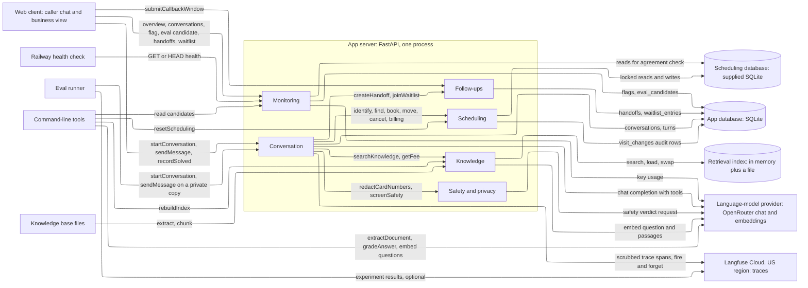

The sign-in check that most designs share does not exist here: callers and staff are anonymous (DP-1, GC-7), so no module guards the others. The only guarded routes are the two admin routes (System-wide contracts).

| Module | What it does | Owns (writes) | Serves | Called by |
|---|---|---|---|---|
| Conversation | Runs one chat: redacts, screens, calls the model, runs its tools, logs every turn, decides the outcome | `conversations`, `turns` | startConversation, sendMessage, recordSolved | client; eval runner; Monitoring (closeIdleConversations) |
| Safety and privacy | Strips card-shaped text; gives a safe, burning-smell or emergency verdict on every caller message | nothing | none to the client | Conversation |
| Knowledge | Holds the retrieval index over current knowledge-base files; returns passages and fee amounts; builds the index | the index file | rebuildIndex (admin, command line) | Conversation; command line |
| Scheduling | Identifies callers, finds windows, books, moves and cancels visits, reads billing, resets the seed | `appointment_slots`, `appointments` (supplied database), `visit_changes` (app database) | resetScheduling (admin, command line) | Conversation; command line |
| Follow-ups | Keeps the work queues for people: handoffs, supervisor callbacks, the waitlist | `handoffs`, `waitlist_entries` | submitCallbackWindow, listHandoffs, markHandoffFollowedUp, listWaitlist | client; Conversation |
| Monitoring | Computes the business view, takes flags, makes test-scenario candidates, answers the health check | `flags`, `eval_candidates` | getOverview, listConversations, getConversation, flagConversation, createEvalCandidate, getHealth, admin reads | client; Railway's health check; command line |

**Key decisions.**
- **The model never names the customer.** Every customer-scoped tool takes the customer from the conversation's matched account, not from a model argument, so a prompt cannot reach another account (AZ-1, FR-3.4).
- **A write needs the caller's own words.** Book, move and cancel carry a verbatim quote from the current caller message and must target something shown in an earlier turn (AZ-2, FR-1.10).
- **Safety runs beside the first model call, and writes wait for it.** Emergency and burning-smell replies are fixed text, not model output (FR-1.1, FR-1.2, PF-1, PF-2).
- **Two SQLite files, no shared transaction.** The booking commits first in the supplied file; the audit row follows in the app file. A booking is never lost for a failed log (RL-2, CT-1, DP-4).
- **Double booking is stopped by one locked transaction per write,** because the supplied schema cannot do it and CT-1 forbids changing it (RL-1).
- **The index is built from a list of approved files.** An unlisted file fails the build; superseded and agent-only files never become passages (FR-2.2, FR-2.7, D-11).
- **Every turn stores the model's raw messages** so the next turn replays them unchanged (`STACK.md` §4, §8).
- **Every conversation gets an outcome.** Idle conversations are closed lazily when someone opens the overview or starts a chat; no scheduler exists (OB-1, HLD §5).

## PRD and wireframe coverage

Every PRD goal and deliverable, and where this document meets it. Items that are documents, not software, are marked.

| PRD item | Met by | Where |
|---|---|---|
| 1. Discovery: top call drivers, ranked, scope chosen | `AUDIT.md` and `analysis/` (a document, done). The ranked drivers become the `intent` labels and the weights file that turns scenario results into projected containment | Conversation → `conversations.intent`; Offline tools → Eval files |
| 2. RAG over the knowledge base, retrieval evaluated alone | Knowledge module: approved-file manifest, checked text for the image and PDF, table rows kept whole, a retrieval question set and report | Knowledge; Offline tools → Eval files |
| 3. Scheduling flow: check, confirm or offer alternatives | Scheduling module and the agent tools | Scheduling; Conversation → Agent tools |
| 4. Escalation: out of scope goes to a human, graceful, with context, no guessing | `escalate` tool, the handoff record, fixed fallback texts, the dollar-figure check, the "not sure" path | Follow-ups; Conversation Must hold |
| 5. Test set, containment 60 to 75%, accuracy on handled drivers, escalation rate on the rest | Scenario, result and weights files and the run summary | Offline tools → Eval files |
| 6. Public web app, interactive | Pages `GET /` and `GET /business`, the caller routes, startup rules for the host | Conversation; System-wide contracts |
| 7. Monitoring: volume, containment, escalations, failures, latency; feedback loop | `getOverview`, the stored fields behind it, flags, test-scenario candidates and the export command | Monitoring (Feedback loop) |
| Deliverable 1: deployed URL | Environments table; `/health` as Railway's health check | Environments |
| Deliverable 2: 3 to 4 minute video | Not software. Its four topics map to: drivers → `AUDIT.md`, chunking and retrieval → Knowledge, escalation → Follow-ups, eval numbers → the run summary | — |
| Deliverable 3: repository, eval set, README with numbers | `eval/` folder (scenarios, weights, retrieval questions, results) and the README, which prints the run summary | Offline tools → Eval files |
| Extra credit: voice | Excluded by the builder (FR-6.1, GC-5) | — |
| Requirements that are tests or documents, not modules: CT-2, SC-1, RL-2, CH-2, EV-6, GC-4, DP-5 | CT-2: four scenarios use MHC-10001 to MHC-10004 and the run summary reports them. SC-1 and RL-2: tests in the regression gate. CH-2: `compareEval`. EV-6, GC-4, DP-5: README and `AUDIT.md` (the service inventory, the clone-to-run steps, the sample agreement) | Offline tools; Environments |

Wireframe states and the contract that draws each:

| Wireframe state | Contract |
|---|---|
| Caller chat: start, quick-reply chips, text box | `startConversation` returns the greeting. Chips are page content; each sends its text as a message |
| Loading ("Looking that up...") | Client only: shown while the `sendMessage` request is open. After 10 s the client adds "still working" (DE-1) |
| Booking: safety question, identification, window buttons, "Nothing earlier? Ask for an earlier window" | `Reply.choices` built from the turn's open windows; the last choice sends "Can you do anything earlier?" |
| Wants earlier: book later plus waitlist, book later only, talk to a person | Three `choices` offered when the agent says no earlier window exists |
| Waitlisted, Confirmed | `Reply.booking` card built from the committed row; `Reply.waitlisted` adds the waitlist line |
| Answer | Plain `Reply` with the `ask_solved` action |
| Handoff: banner, morning/afternoon/evening picker | `status: handed_off`, `banner: handoff`, action `choose_callback_window` → `submitCallbackWindow` |
| Safety stop: red banner, conversation ends | `status: safety_stop`, `banner: safety_stop`, fixed text. A handoff of kind `safety_stop` is recorded so the wireframe's "flagged for a safety follow-up" is true (open question 1) |
| Error ("Simulate an outage" chip) | `banner: error` with action `request_callback`; the chip sets `simulateOutage` on `sendMessage`. The page shows the chip only when `startConversation` returns `demoFaults: true` (open question 2) |
| Did this solve it? → Thanks / not solved | `recordSolved`; "no" keeps the conversation open and offers a person |
| New conversation | `startConversation`; identity lives only on the server under the conversation id, so nothing carries over (FR-5.2) |
| Business view: status strip, success metric with 7-day line and 60 to 75% band, three supporting metrics, what just happened, guarantees table, 24 h first-reply line, spend against $100. The 24 h ping strip and the "answered in" time on the public-URL tile are dropped with the uptime monitor (builder, 2026-10-19) | `getOverview` response fields (Monitoring → API) |
| Handoffs tab with "mark followed up" | `listHandoffs`, `markHandoffFollowedUp` |
| Waitlist tab | `listWaitlist` |
| Conversations tab: transcript, tools called, cost, flag with note, turn into test scenario | `listConversations`, `getConversation`, `flagConversation`, `createEvalCandidate` |
| (Addition to the wireframe) "Open trace" link per turn in the conversation detail | `TurnView.traceId` (added 2026-10-18, approved by the builder) |
| (Additions to the wireframe, approved by the builder on 2026-10-19 for the 2026-10-21 deadline) a "Conversations by day and outcome" block on the Overview (FR-5.3); the zone on each waitlist row (FR-5.7); "after an error" beside the reason on failure-driven handoff rows (OB-3); a safety-stop mark on safety-stop handoff rows (FR-5.8); a spend banner when the CO-1 alert is on; "Diagnostic fee waived for members" on a member's booking card (FR-1.10); the turn-cap text | `Overview.volume`; `WaitlistView.zone`; `HandoffView.byError` and `kind`; `Overview.spend.alert`; `Booking.diagnosticFeeWaived`; Conversation → Must hold → Fixed texts |

## Existing system

The supplied scheduling database was inspected read-only on 2026-10-18 (the SQLite file and `SCHEMA.md`). Everything else is new.

| HLD entity | Existing | Status | Change |
|---|---|---|---|
| Customer | `customers` | exists | none (CT-1) |
| Technician | `technicians` | exists | none |
| Slot | `appointment_slots` | exists | none; the app updates `status` only |
| Appointment | `appointments` | exists | none; the app inserts rows and updates `status` and `slot_id` |
| Invoice | `invoices` | exists | none; read only |
| Conversation, Turn, Handoff, WaitlistEntry, Flag | — | new, in the app database | — |
| Scenario and Eval result | — | new, files in the repository | — |
| (not in HLD) booking audit, test-scenario candidate | — | new, in the app database | `visit_changes`, `eval_candidates` (upstream fixes) |

What the inspection found, and how this design treats it:
- **Foreign keys are off, and `appointments.slot_id` has no unique rule.** The database cannot stop two appointments on one slot. Scheduling does it in code (Scheduling → Must hold, RL-1). At inspection every `booked` slot had exactly one appointment and every appointment sat on a `booked` slot (159 each), which gives the invariant query its baseline.
- **`appointments.created_at` is a date-only text** (`2026-10-07`). New rows use the reference date in the same form (assumption A-3).
- **Two customers can share a name** (at least five names occur twice); phone numbers are all distinct. A name alone never identifies anyone, and a name that matches two rows through the second identifier is treated as no match.
- **Nine cities are mapped to zones in `SCHEMA.md`; `service_area.md` adds Dripping Springs and Manor,** which have no zone. A caller there is serviced but cannot be booked: open question 3.
- **A freed slot goes back to `open`** (`SCHEMA.md`, VR-6), even if it was `reserved_members` before it was booked. Member-only slots can thereby become public after a cancel. Kept as the supplied behaviour.
- **Journal mode and indexes of the supplied file are left as they are.** The app opens it with a bounded wait for locks so a busy file fails fast (DE-2).

## Data flows

| Operation | Path | Sync / async | Committed before response? |
|---|---|---|---|
| startConversation | client → Conversation.startConversation → closeIdleConversations → insert `conversations` | sync | yes |
| sendMessage | client → Conversation.sendMessage → Safety.redactCardNumbers → (Safety.screenSafety beside the first model call) → agent tools (Knowledge, Scheduling, Follow-ups) → insert `turns`, update `conversations` → Reply | sync | scheduling and handoff writes commit before the reply says they happened. The turn row is written after; a failed log never undoes a booking |
| recordSolved | client → Conversation.recordSolved → insert `turns`, update `conversations` | sync | yes |
| submitCallbackWindow | client → Follow-ups.setCallbackWindow (or createHandoff after a fallback) → update `handoffs` | sync | yes |
| getOverview | client → Monitoring.getOverview → Conversation.closeIdleConversations → read `conversations`, `turns`, `visit_changes`, supplied `appointments` and `appointment_slots`, `handoffs`, `flags` → OpenRouter key usage | sync | n/a (read) |
| listConversations, getConversation | client → Monitoring (listConversations first runs Conversation.closeIdleConversations) → read `conversations`, `turns`, `handoffs`, `flags`, `eval_candidates`, supplied `customers` | sync | n/a |
| flagConversation | client → Monitoring → insert `flags` | sync | yes |
| createEvalCandidate | client → Monitoring → read the conversation → insert `eval_candidates` | sync | yes |
| listHandoffs, markHandoffFollowedUp | client → Follow-ups → read or update `handoffs` | sync | yes |
| listWaitlist | client → Follow-ups → read `waitlist_entries` | sync | n/a |
| getHealth | Railway's health check → Monitoring.getHealth → reply | sync | n/a (read) |
| admin reset-scheduling | operator → Scheduling.resetScheduling → supplied database | sync | yes |
| admin rebuild-index | operator → Knowledge.rebuildIndex → embeddings → index file → in-memory swap | sync | yes |
| admin eval-candidates | command line → Monitoring → read `eval_candidates` | sync | n/a |
| runEval, rebuildIndex, resetScheduling, exportEvalCandidates | command line → the same module functions, or the admin routes when pointed at the deployed app | sync | as above |

A turn, with the safety screen beside the first model call and writes held until the verdict:

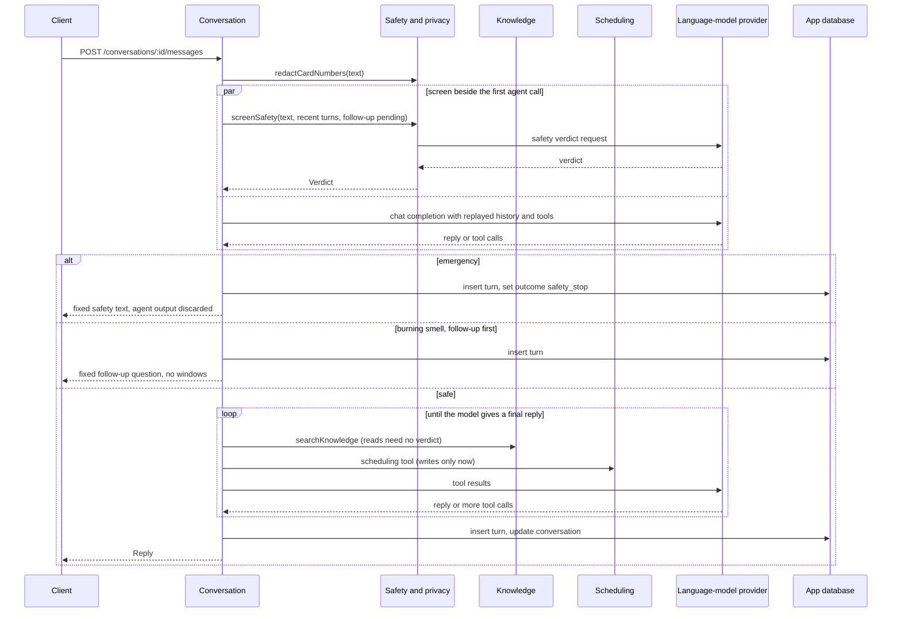

A booking: the order of the two writes is the contract.

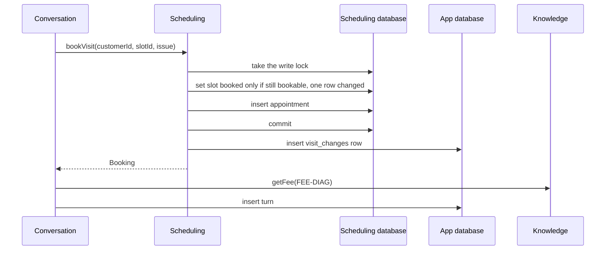

If the second step (audit row) fails, the booking stands and the failure is logged. If the commit fails, nothing was written and `SchedulingUnavailable` goes back to the model as a failed tool result (DE-2).

A handoff and its callback window:

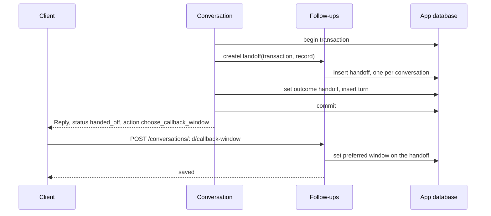

A waitlist join happens inside a turn:

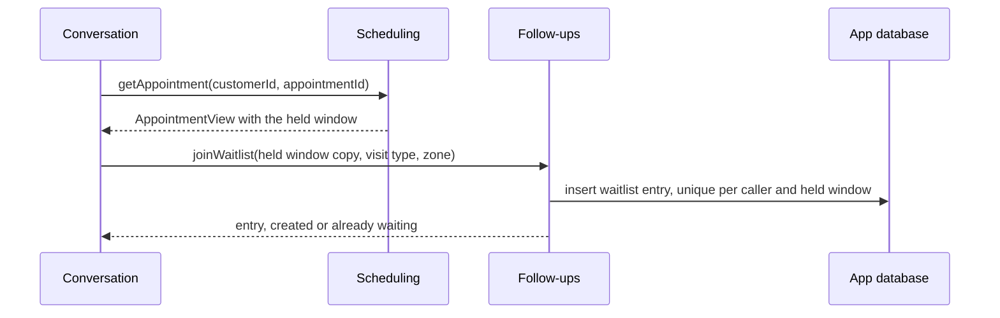

The overview:

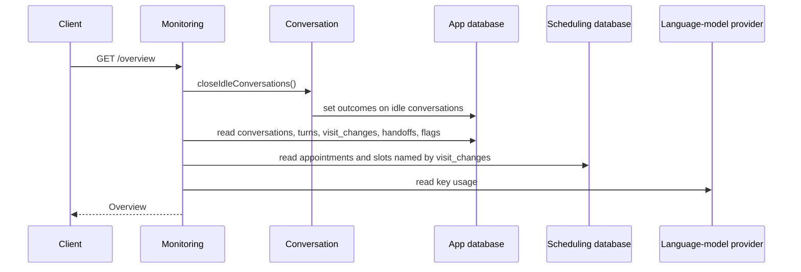

Rebuilding the index:

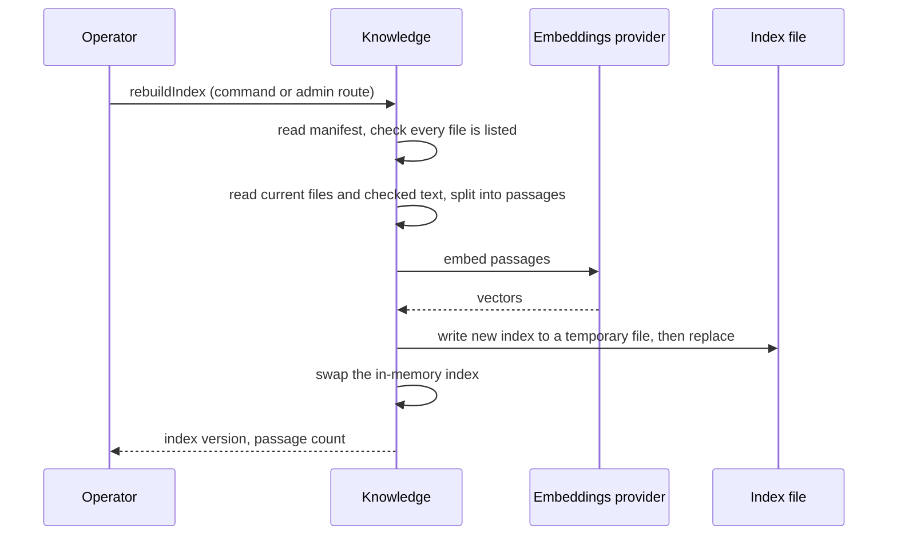

## Database schema

All tables live in the one database of their kind; "owned by" means only that module's code writes the table. Any module may read it. **Types** are SQLite's: `TEXT`, `INTEGER`, `REAL`. Timestamps are `TEXT` in UTC ISO-8601 with a `Z`. Ids the caller can see are random UUIDs in `TEXT`; others are `INTEGER` keys. JSON columns hold `TEXT` with `json_valid` checked. Booleans are `INTEGER` 0 or 1. No database-level access policy exists: neither file is reachable from a client, and the app is the only writer (the reviewer may open the supplied file read-only).

**Migrations and settings of the app database.** The app database's tables are created and changed by numbered migration scripts applied in order at start and tracked by SQLite's schema version; the app database is opened with write-ahead logging (plain journal as the fallback, open question 9), a lock-wait timeout, and foreign keys enforced. None of this applies to the supplied file, whose journal mode, schema and constraints are left as supplied (CT-1).

### Supplied scheduling database (existing, unchanged)

Five tables exactly as in `SCHEMA.md`. This design relies on them as follows.

| Table | Used for | Notes |
|---|---|---|
| `customers` | identify the caller, zone from `city`, membership tier, system brand and install date | read only |
| `technicians` | technician name on a window | read only |
| `appointment_slots` | windows; `status` is `open`, `booked`, `reserved_members` or `blocked` | Scheduling updates `status` only |
| `appointments` | the booked visit; `status` is `scheduled`, `completed`, `cancelled` or `no_show` | Scheduling inserts rows and updates `slot_id` (move) and `status` (cancel) |
| `invoices` | balance and line items | read only |

### Scheduling — `visit_changes` (app database)

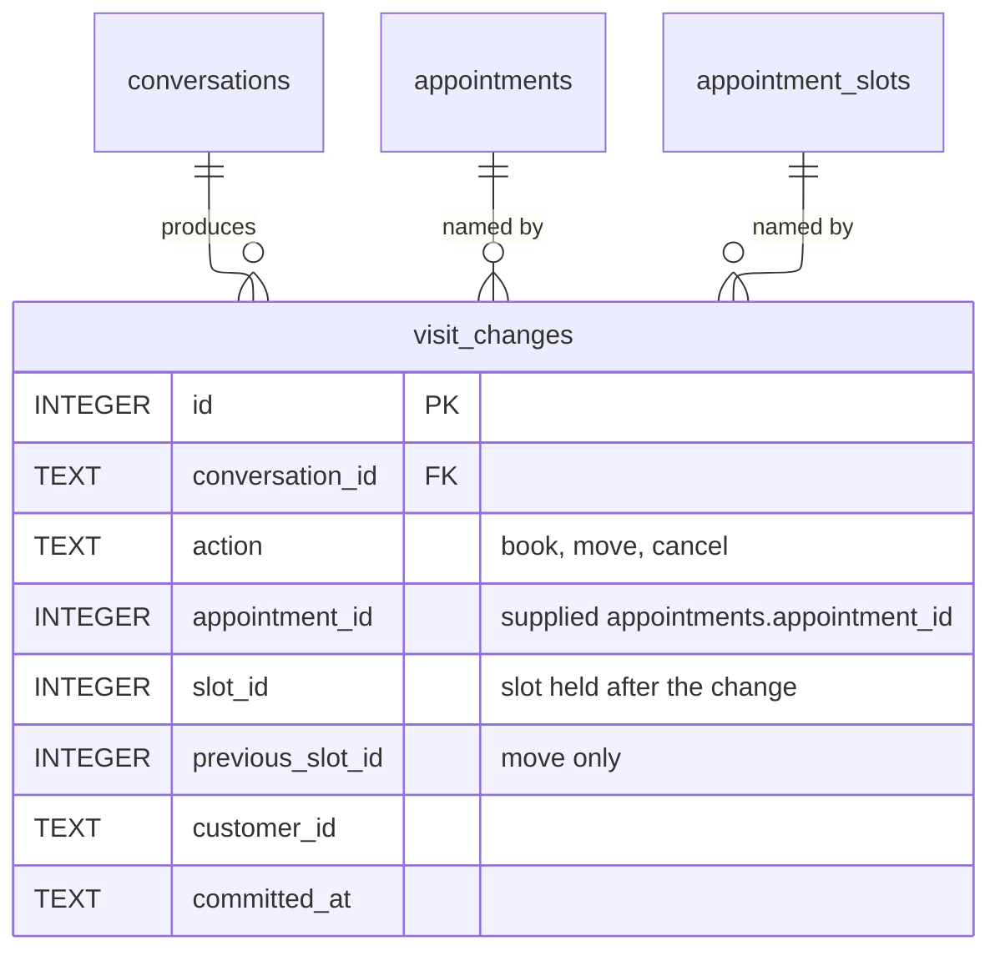

#### `visit_changes` — owned by Scheduling

One row for every book, move or cancel the app committed in the supplied database. It exists because the supplied tables hold no link to a conversation, and the booking-agreement metric and the booking-completion metric need one (KEY_METRICS).

| Column | Type | Null | Default | Meaning |
|---|---|---|---|---|
| id | INTEGER | no | autoincrement | key |
| conversation_id | TEXT → conversations.id | no | | the conversation that made the change |
| action | TEXT | no | | `book`, `move`, `cancel` (more may be added) |
| appointment_id | INTEGER | no | | `appointments.appointment_id` in the supplied file (no foreign key across files) |
| slot_id | INTEGER | no | | the slot now held; for a cancel, the slot that was freed |
| previous_slot_id | INTEGER | yes | | a move only: the slot that was freed |
| customer_id | TEXT | no | | the matched customer |
| confirmed_date | TEXT | yes | | date the committed row gave; null for a cancel |
| confirmed_window | TEXT | yes | | window the committed row gave; null for a cancel |
| confirmed_technician | TEXT | yes | | technician name the committed row gave; null for a cancel |
| late_fee_applied | INTEGER | yes | | move or cancel: 1 when the window started fewer than 24 hours after the reference clock; null for a book |
| committed_at | TEXT | no | now | when the supplied-database commit finished |
| retired_at | TEXT | yes | | set on every existing row when the seed reset runs; the agreement check ignores retired rows, because the reset removes the appointments they name and the supplied file then reuses their ids |

- **Constraints:** `action` check against the listed values; `previous_slot_id` not null when `action = 'move'`.
- **Indexes:** `(conversation_id)` for the conversation detail and booking completion; `(appointment_id)` for the agreement check; `(committed_at)` for the 24 h window.

### Conversation — `conversations`, `turns`

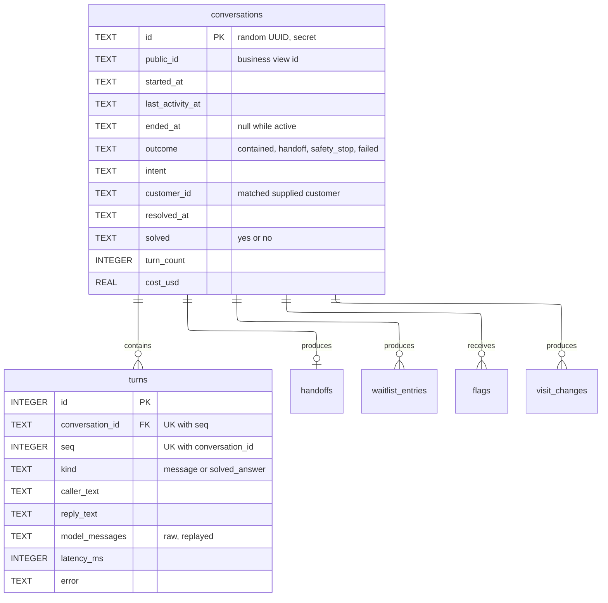

#### `conversations` — owned by Conversation

One chat from the first message to its end.

| Column | Type | Null | Default | Meaning |
|---|---|---|---|---|
| id | TEXT | no | random UUID | key; also the only credential the caller holds. Never returned by any Monitoring or Follow-ups route |
| public_id | TEXT | no | random, different from `id` | the id the business view uses to name a conversation; it opens nothing in the caller routes |
| started_at | TEXT | no | now | |
| last_activity_at | TEXT | no | now | updated on every turn; drives the idle close |
| ended_at | TEXT | yes | | set together with `outcome` |
| outcome | TEXT | yes | | `contained`, `handoff`, `safety_stop`, `failed`; null while the conversation is active (REQUIREMENTS Definitions) |
| outcome_reason | TEXT | yes | | why it ended as it did: `provider_failure`, `replay_rejected`, `scheduling_unavailable`, `turn_cap`, `idle_unresolved`, and so on (more may be added) |
| intent | TEXT | no | `unknown` | what the caller wants now, from the agent's latest status report: `book_visit`, `change_visit`, `policy_question`, `warranty_question`, `membership_question`, `billing_lookup`, `billing_dispute`, `membership_change`, `complaint_or_refund`, `safety`, `new_system_quote`, `technician_late`, `out_of_scope`, `other` (more may be added) |
| customer_id | TEXT | yes | | the matched `customers.customer_id`; no foreign key across files |
| intents_seen | TEXT (JSON array) | no | `[]` | every distinct intent the agent reported, in order; a booking followed by a membership question keeps both (FR-2.9) |
| identify_attempts | INTEGER | no | 0 | failed identification tries; caps guessing |
| resolved_at | TEXT | yes | | when the agent reported the caller's need met |
| solved | TEXT | yes | | the caller's tap: `yes` or `no` (FR-5.6) |
| solved_at | TEXT | yes | | |
| turn_count | INTEGER | no | 0 | equals the number of `turns` rows with `kind = 'message'` |
| cost_usd | REAL | no | 0 | sum of `turns.cost_usd` |

- **Constraints:** unique `(public_id)`; `outcome` check against the four values; `solved` check against `yes`, `no`; `outcome` is null exactly when `ended_at` is null.
- **Indexes:** `(started_at desc)` for the list and the 7-day window; `(outcome, started_at)` for the outcome filter and the success ratio; a partial index on `last_activity_at` where `outcome` is null, for the idle sweep.

#### `turns` — owned by Conversation

One caller message and the reply, or one tap on "did this solve it".

| Column | Type | Null | Default | Meaning |
|---|---|---|---|---|
| id | INTEGER | no | autoincrement | key |
| conversation_id | TEXT → conversations.id | no | | |
| seq | INTEGER | no | | 1-based order within the conversation |
| kind | TEXT | no | `message` | `message` or `solved_answer` (more may be added); latency metrics use `message` only |
| created_at | TEXT | no | now | |
| caller_text | TEXT | no | | what the caller sent, after card-shaped text was removed (CP-1) |
| reply_text | TEXT | no | | exactly what the caller saw |
| model_messages | TEXT (JSON array) | no | `[]` | the raw messages exchanged with the model this turn, in order, as the provider returned them: the caller message, assistant messages with their tool calls and reasoning notes, and tool results. Replayed unchanged on later turns. Always a valid sequence: every tool call is followed by its result |
| safety_verdict | TEXT | yes | | `safe`, `burning_followup`, `emergency`, or `unscreened` when the screen failed |
| tools_called | TEXT (JSON array) | no | `[]` | `[{name, ok, ms, error}]` for the business view and OB-1 |
| retrieved | TEXT (JSON array) | no | `[]` | `[{passageId, sourceFile, score}]` for every search this turn; the passage text itself is in `model_messages` (VR-9) |
| offered | TEXT (JSON object) | no | `{}` | `{slotIds: [...], appointmentIds: [...]}` the model was given this turn; write tools check a target against earlier turns' `offered` |
| has_write | INTEGER | no | 0 | 1 when a book, move or cancel committed this turn (PF-2) |
| latency_ms | INTEGER | no | | request received to reply returned |
| error | TEXT | yes | | `provider_timeout`, `provider_error`, `replay_rejected`, `scheduling_unavailable`, `embedding_unavailable`, `screen_unavailable`, `figure_check_failed`, and so on (more may be added) |
| fallback_used | INTEGER | no | 0 | 1 when the reply is a fixed fallback text (DE-1) |
| trace_id | TEXT | yes | | the Langfuse trace for this turn, so the business view can link to it; null when tracing was off or failed |
| prompt_tokens | INTEGER | yes | | as the provider reported |
| completion_tokens | INTEGER | yes | | as the provider reported |
| cost_usd | REAL | no | 0 | the provider's reported cost, else tokens times the configured price; never null (OB-1) |
| cost_source | TEXT | no | `estimated` | `reported` or `estimated` |

- **Constraints:** unique `(conversation_id, seq)`; `kind` check; `model_messages`, `tools_called`, `retrieved`, `offered` pass `json_valid`.
- **Indexes:** the unique key covers per-conversation reads; `(created_at)` for the 24 h latency and error series.

### Follow-ups — `handoffs`, `waitlist_entries`

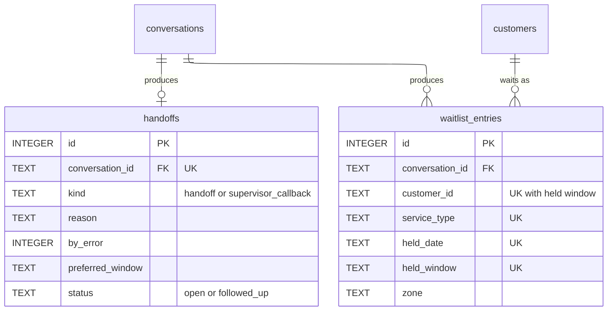

#### `handoffs` — owned by Follow-ups

A person must act: a handoff, or a supervisor callback. Holds the handoff record of REQUIREMENTS Definitions as separate fields so completeness can be checked (FR-4.2, EV-3).

| Column | Type | Null | Default | Meaning |
|---|---|---|---|---|
| id | INTEGER | no | autoincrement | key |
| conversation_id | TEXT → conversations.id | no | | |
| kind | TEXT | no | | `handoff`, `supervisor_callback` or `safety_stop` (more may be added) |
| reason | TEXT | no | | why: `no_account_match`, `caller_asked_for_person`, `out_of_scope`, `no_document_answer`, `documents_disagree`, `no_plumber_in_zone`, `outside_service_area`, `membership_change`, `billing_dispute`, `refund_demand`, `complaint`, `manager_request`, `provider_failure`, `scheduling_unavailable`, `turn_cap`, and so on (more may be added) |
| by_error | INTEGER | no | 0 | 1 when the handoff was forced by a failure, not chosen by policy (OB-3) |
| customer_id | TEXT | yes | | matched customer, if any |
| caller_name | TEXT | yes | | copy of the matched customer's name, or the name an unmatched caller gave (then `stated_by_caller` is 1) |
| caller_phone | TEXT | yes | | copy of the matched customer's phone, or the number an unmatched caller gave, so staff can call |
| stated_by_caller | INTEGER | no | 0 | 1 when name and phone were given by the caller and not checked against an account |
| intent | TEXT | no | | what the caller wanted; `unknown` when no label was set |
| told_caller | TEXT | no | | what the agent told the caller |
| summary_source | TEXT | no | `agent` | `agent` or `system` (written from the transcript when the model could not) |
| preferred_window | TEXT | yes | | `morning`, `afternoon` or `evening`; null until chosen |
| status | TEXT | no | `open` | `open` or `followed_up` |
| created_at | TEXT | no | now | |
| followed_up_at | TEXT | yes | | |

- **Constraints:** unique `(conversation_id)` — a conversation ends at its handoff, so there is at most one (FR-4.1); `preferred_window` check against the three values; `status` check; `reason`, `intent` and `told_caller` not empty.
- **Indexes:** `(status, created_at)` for the queue and the "waiting" count.

#### `waitlist_entries` — owned by Follow-ups

A caller who holds a later visit and wants an earlier window (FR-1.15). Holds a copy of the held window, not a link to the appointment, so the seed reset cannot leave it pointing at nothing (DP-4).

| Column | Type | Null | Default | Meaning |
|---|---|---|---|---|
| id | INTEGER | no | autoincrement | key |
| conversation_id | TEXT → conversations.id | no | | |
| customer_id | TEXT | no | | the matched customer (a waitlist needs a held visit, so an account) |
| caller_name | TEXT | no | | copy |
| caller_phone | TEXT | no | | copy |
| service_type | TEXT | no | | visit type of the held visit |
| zone | TEXT | no | | zone to watch for an earlier window |
| held_date | TEXT | no | | date of the visit the caller keeps |
| held_window | TEXT | no | | window of that visit |
| created_at | TEXT | no | now | |

- **Constraints:** unique `(customer_id, service_type, held_date, held_window)` — asking twice for the same request writes one row (VR-10).
- **Indexes:** `(created_at)` for the list, oldest first.

### Monitoring — `flags`, `eval_candidates`

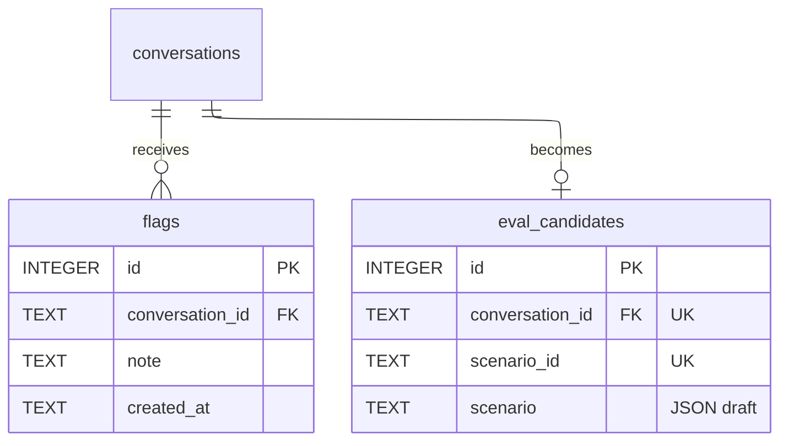

#### `flags` — owned by Monitoring

| Column | Type | Null | Default | Meaning |
|---|---|---|---|---|
| id | INTEGER | no | autoincrement | key |
| conversation_id | TEXT → conversations.id | no | | |
| note | TEXT | no | | what was wrong (FR-5.4) |
| created_at | TEXT | no | now | |

- **Constraints:** `note` not empty. No author column: nobody signs in (GC-7).
- **Indexes:** `(conversation_id)`.

#### `eval_candidates` — owned by Monitoring

A draft test scenario made from a logged conversation (OB-4).

| Column | Type | Null | Default | Meaning |
|---|---|---|---|---|
| id | INTEGER | no | autoincrement | key |
| conversation_id | TEXT → conversations.id | no | | |
| scenario_id | TEXT | no | | name the file will have, `CAND-` plus the first 8 characters of the conversation id |
| scenario | TEXT (JSON) | no | | a Scenario draft (see Offline tools → Eval files) with the caller's messages, the observed outcome, and empty expected fields for a person to fill in |
| created_at | TEXT | no | now | |

- **Constraints:** unique `(conversation_id)`; unique `(scenario_id)`.

No `pings` or `alerts_sent` table: the uptime monitor and the spend alert message were dropped (builder, 2026-10-19).

## Shared types

Used by more than one module or by the client. `*View` types are what the business view and the eval runner read.

```
Reply {                      what sendMessage returns (recordSolved returns its own shape, see Conversation → API)
  conversationId   uuid
  status           active | handed_off | safety_stop | ended   (more may be added)
  text             what the caller reads
  banner           none | handoff | safety_stop | error   (more may be added)
  choices          [Choice]    quick replies, may be empty
  booking          Booking | null   confirmation card, built from the committed row in this turn
  waitlisted       boolean     the card also shows the waitlist line
  actions          [ask_solved | choose_callback_window | request_callback | new_conversation]  (more may be added)
  turn             { seq: integer, latencyMs: integer }
}

Choice { label: string, text: string }      clicking sends `text` as the caller's next message

Booking {                    a committed visit, as the database row says
  appointmentId       integer
  slotId              integer
  date                YYYY-MM-DD
  window              e.g. 08:00-12:00
  technicianName      string
  serviceType         hvac_repair | hvac_tune_up | plumbing   (estimate is not offered in v1)
  zone                north | central | south
  diagnosticFeeCents  integer | null   added by Conversation from Knowledge.getFee, said once; null when the price book is unavailable (the card omits the fee line)
  diagnosticFeeWaived boolean   added by Conversation: true for standard and plus members
}

Window {                     one open window offered to a caller
  slotId, date, window, serviceType, zone, technicianName
  memberOnly          boolean   the slot is reserved_members
}

CustomerRef {                what the model may know about the matched caller
  customerId, name, city
  zone                north | central | south | null   null when the city has no zone
  membershipTier      none | standard | plus
  membershipRenewalDate  date | null
  systemBrand         string | null
  systemInstallDate   date | null
}                            (no phone, email or street address)

AppointmentView {
  appointmentId, date, window, technicianName, serviceType, zone, issue
  lateCancelFeeApplies  boolean   fewer than 24 h before the window starts, against the reference clock
}

Invoice { invoiceId, issuedDate, dueDate, amountCents, balanceCents, lineItems: [{ desc: string, cents: integer }] }

Passage {
  passageId     string
  sourceFile    path of the original file in the knowledge base
  section       heading or row label it came from
  kind          text | table_rows | price_row | image_text | pdf_text   (more may be added)
  text          string
  score         number   higher is closer
}

Fee { code: string, cents: integer, sourceFile: string }       e.g. FEE-DIAG, FEE-LATE, FEE-AH, FEE-HOL

Verdict { verdict: safe | burning_followup | emergency, reason: string }    (more verdicts may be added; reason never contains the message)

HandoffView {
  id, conversationPublicId, kind, reason, byError
  caller { customerId | null, name | null, phone | null, city | null, zone | null, statedByCaller: boolean }   statedByCaller true when the name and phone were given by an unmatched caller and are unverified
  intent, toldCaller, summary (reason and toldCaller in one line), summarySource
  preferredWindow | null, status, createdAt, followedUpAt | null
}

WaitlistView {
  id, conversationPublicId, caller { customerId, name, phone, city }
  serviceType, zone, held { date, window }, createdAt, waitingSeconds
}

ConversationSummary {
  publicId, startedAt, endedAt | null, intent | null, outcome | null, outcomeReason | null
  turnCount, costUsd, solved | null, flagged: boolean, hasHandoff: boolean
  customerName | null           read from the supplied customers table
}

TurnView {
  seq, kind, callerText, replyText
  toolsCalled [{ name, ok, ms }], retrieved [{ sourceFile, score }]
  safetyVerdict | null, latencyMs, error | null, fallbackUsed, costUsd
  traceId | null               the turn's Langfuse trace, so the conversation detail can link to it (added 2026-10-18, approved by the builder, for the 2026-10-21 deadline)
}

ConversationDetail {
  summary: ConversationSummary
  turns: [TurnView]
  handoff: HandoffView | null
  flags: [{ id, note, createdAt }]
  evalCandidate: { scenarioId } | null
}

ErrorBody { error: string, message: string }          see System-wide contracts
```

## Module: Conversation — runs one chat

### What it does
Takes a caller message, removes card-shaped text, screens it, lets the model answer with the tools below, commits any write before the reply says it happened, logs the turn, and decides how the conversation ends.

### Owns
Writes `conversations` and `turns`. Reads `customers` (through Scheduling), `handoffs`, `visit_changes`.

### API

```
{startConversation}   POST /conversations                          serves FR-5.2, HLD I-6
Caller     anyone; the eval runner
Request    none
Response   201 { conversationId: uuid, status: "active", greeting: string, demoFaults: boolean }
Errors     429 rate_limited — too many new conversations from this address
           (more may be added)
Also       runs closeIdleConversations first
```

```
{sendMessage}   POST /conversations/:id/messages                   serves FR-1 to FR-4, PF-1, PF-2, DE-1
Caller     whoever holds the conversation id (the caller's page; the eval runner)
Request    { text: string, simulateOutage?: boolean }
Response   200 Reply
Errors     404 conversation_not_found
           409 conversation_ended — outcome already set
           409 turn_in_progress — another message for this conversation is still being answered
           409 turn_limit_reached — the conversation hit its turn cap; it is ended with outcome failed
           413 message_too_long
           422 empty_message
           429 rate_limited — too many messages from this address
           (more may be added)
Notes      A model or database failure is not an HTTP error: it returns 200 with banner "error" and a fixed fallback text (DE-1, DE-2).
           simulateOutage is honoured only when the demo fault setting is on (open question 2). It skips every model call and takes the provider-failure path.
```

```
{recordSolved}   POST /conversations/:id/solved                    serves FR-5.6, HLD I-5
Caller     whoever holds the conversation id
Request    { answer: "yes" | "no" }
Response   200 { saved: true, status: "ended" | "active", text: string, actions: [...] }
           yes → status ended, outcome contained; no → status stays active, text offers a person
Errors     404 conversation_not_found
           409 already_answered
           409 conversation_ended — it ended by handoff, safety stop or failure
           422 invalid_answer
```

In the Monitoring and Follow-ups list routes, `:id` and any conversation reference is the conversation's `public_id`; the caller routes above take the secret `id`. A caller's `id` is never shown to the business view (a visitor to the open business view could otherwise take over a live caller's conversation).

Pages: `GET /` is the caller chat; `GET /business` is the business view. Both are served by the app and call the same module functions as the routes (see System-wide contracts, Content negotiation).

### Agent tools

The model sees these tools. Each is a thin call into a module interface. Arguments marked *injected* are never taken from the model.

| Tool | Calls | Model supplies | Injected by Conversation | Notes |
|---|---|---|---|---|
| `search_knowledge` | Knowledge.searchKnowledge | query | | read |
| `identify_customer` | Scheduling.identifyCustomer | name and at least one of phone, account number, service address | | on a match the conversation's `customer_id` is set; on no match `identify_attempts` goes up; past a small limit the tool refuses and the agent hands off |
| `find_open_windows` | Scheduling.findOpenWindows | serviceType, preferred date or window if any | customerId | read |
| `lookup_my_appointments` | Scheduling.listAppointments | none | customerId | read |
| `book_visit` | Scheduling.bookVisit | slotId, issue, callerQuote | customerId | write |
| `move_visit` | Scheduling.moveVisit | appointmentId, newSlotId, callerQuote | customerId | write; the late-change fee amount is added from Knowledge.getFee |
| `cancel_visit` | Scheduling.cancelVisit | appointmentId, callerQuote | customerId | write; the fee amount is added from Knowledge.getFee |
| `get_my_billing` | Scheduling.getBilling | none | customerId | read |
| `send_payment_link` | Scheduling.createPaymentLink | invoiceId | customerId | no database write; returns a stub link |
| `join_waitlist` | Follow-ups.joinWaitlist | appointmentId | customerId, held window from Scheduling.getAppointment | |
| `escalate` | Follow-ups.createHandoff | kind, reason, intent, toldCaller, callerName and callerPhone if the caller gave them and was not matched | conversationId, customerId, summarySource | ends the conversation |
| `report_status` | none (updates `conversations`) | intent, resolved | | may be part of the final structured reply instead; the spike decides (STACK §20) |

### Jobs and messages

```
{closeIdleConversations}   on startConversation, getOverview and listConversations        serves OB-1
Trigger proof  internal call; no outside trigger
Payload        none
Reads          conversations where outcome is null and last_activity_at is older than the idle limit
Writes         conversations.outcome, outcome_reason, ended_at:
               no message was ever sent → closed with outcome failed, reason no_message, and left out of every metric
               resolved and no handoff → contained
               otherwise → failed with reason idle_unresolved
Twice-safe     yes — only rows with a null outcome change
On failure     the sweep is skipped, the caller's request still succeeds, the next call retries
```

### Interface for other modules

```
closeIdleConversations(now) -> integer
  Closes idle conversations and returns how many. Called by Monitoring.
  Callers rely on: never changes a conversation that already has an outcome.

endWithHandoff(transaction, conversationId) -> void
  Sets outcome handoff and ended_at in the caller's transaction. Called by Follow-ups when it creates a system-written handoff after a fallback, so a handoff row and an active conversation never coexist.
  Callers rely on: idempotent.
```

### Calls out

| To | Sent | Comes back | Test double |
|---|---|---|---|
| Model provider (OpenRouter chat) | the pinned dated model slug; the instructions; every earlier turn's `model_messages` in order; this turn's redacted caller message; the tools; low thinking; routing pinned to one provider route with fallbacks off; an explicit per-call timeout; no automatic retries; usage reporting on | an assistant message (text and/or tool calls, with its reasoning notes), tokens and cost | a scripted fake that returns canned messages and can fail on demand: timeout, 402, 429, malformed, rejects replay |
| Safety (through Safety and privacy) | see that module | a Verdict | the same fake |

Provider account settings: input and output logging off (`STACK.md` §7).

| To | Sent | Comes back | Test double |
|---|---|---|---|
| Langfuse Cloud, US region (traces) | per turn, a trace with spans for the safety screen, each model call and each tool call: timings, token counts, cost, model, tool names, outcome, and the redacted caller and reply text; the session id is the conversation's public id | nothing the turn needs | an in-memory recorder; tracing off |

Tracing is fire-and-forget: a Langfuse error, timeout or outage never delays or fails a turn. OpenRouter's own Broadcast feed to Langfuse is not used, because it sends before the card scrubber runs.

### Must hold
- Only Conversation writes `conversations` and `turns`.
- Card-shaped text is removed before the screen, the model, the database and the logs, and the model sees a placeholder saying a card number was removed (CP-1).
- **Safety gate.** No write tool runs, and no window is offered, in a turn until the screen has returned `safe`. `emergency` ends the turn with fixed text, discards any model output, sets the outcome to `safety_stop` and records a `safety_stop` handoff in the same transaction; the conversation takes no later turn. The fixed text says the account is flagged only when a customer was matched, otherwise that the conversation is flagged (FR-1.1, VR-2). `burning_followup` returns the fixed follow-up question only (FR-1.2). A screen that fails is `unscreened`: no write, no windows, the turn takes the provider-failure path.
- **No guessing the account.** No tool takes a customer id from the model. Customer-scoped tools run only after `identify_customer` matched in this conversation (AZ-1, FR-1.3, FR-3.4).
- **Writes need the caller's words.** `book_visit`, `move_visit` and `cancel_visit` run only if `callerQuote` appears verbatim in the current caller message and the targeted slot or appointment is in an earlier turn's `offered` (AZ-2, FR-1.10). The code proves a quote is present, not that it means yes; AZ-2 is verified by the eval.
- **Nothing is confirmed that was not committed.** A booking card appears only from a write committed in this turn. If a write commits and the turn then fails, the reply is built from the committed row, not the generic error (DE-2, RL-2, VR-8). A failed write goes back to the model as a failed result that forbids confirming and requires offering a person.
- **Confirmations match the row.** A date, window or technician name in the reply text that confirms a book, move or cancel must equal the committed row of this turn. A reply that fails is replaced by the booking card with a fixed confirmation line, and the turn records `error = confirmation_mismatch` so the overview counts it (VR-8) **[assumed]**.
- **No unsupported dollar figure.** Every dollar figure in a reply appears, ignoring formatting, in this conversation's tool results (retrieved passages, fee amounts, the caller's own records). This is looser than VR-9's "retrieved for that reply" because an earlier turn's passage may still be true; the eval checks per reply. A reply that fails the check is not shown; the caller gets the "not sure, would you like a person" reply (VR-9, FR-1.13, AZ-3) **[assumed]**.
- **No promises.** Replies for a supervisor callback use fixed wording that states one business day (FR-3.5, FR-4.3). A reply that promises a refund, a waiver, a callback "today" or in two days, or a price the account is not entitled to, is withheld and replaced by the "not sure, would you like a person" reply (AZ-3, FR-2.8, FR-1.12) **[assumed]**. The eval checks the same rules.
- **Replay is exact.** `model_messages` is stored as received and replayed unchanged and in order; a provider that rejects the replay ends the conversation with the provider-failure reply, outcome `failed`, reason `replay_rejected`.
- **Ask for the tap.** A reply carries `ask_solved` exactly when the agent reported the need resolved this turn and no handoff exists for the conversation (FR-5.6).
- **One turn at a time per conversation.** A second message while one is in flight is refused with `turn_in_progress`.
- **Deadline.** A turn ends with a reply within the DE-1 limit of its start, covering retries and tool rounds. A fallback reply sets `fallback_used` and `error`, offers a person, and shows no stack trace or provider text.
- **Outcome.** An outcome is set exactly once. `contained` is never set while a handoff exists. `handoff` is set in the same transaction that creates the handoff.
- **Fixed texts.** The emergency message, the burning-smell question, the fallback, the turn-cap text, the supervisor-callback wording and the solved-tap texts are fixed wording taken from the wireframe, not model output. The wireframe has no turn-cap text, so it is fixed here: "This conversation has reached its limit. Please start a new conversation, or ask for a call back." (approved by the builder on 2026-10-19).
- Every turn stores `latency_ms`, `tools_called`, `retrieved`, cost and any error (OB-1).
- **Traces carry only scrubbed text.** Spans are built from text left after card-shaped strings were removed, plus ids, tool names, outcome, cost and latency; a masking step drops any run of 13 to 19 digits before a span leaves the app (CP-1). Raw model messages and reasoning notes are not sent. The secret conversation id is never a span attribute.

### Failure behaviour

| Failure | What the caller sees | What is recorded |
|---|---|---|
| Model timeout, error, 402 or 429 | fallback text, offer of a person, banner error | turn with `error`, `fallback_used`; conversation stays active |
| Replay rejected | fallback text, conversation ends | outcome `failed`, reason `replay_rejected` |
| Scheduling database unreadable or write fails | the model is told the result failed, offers a person; the caller is never told a booking exists | tool result with the error; turn `error = scheduling_unavailable` |
| Embedding or index unavailable | the search tool's result forbids answering a policy question and requires offering a person; never an error | turn `error = embedding_unavailable` |
| Screen fails | fallback text, no windows or writes | `safety_verdict = unscreened`, turn `error = screen_unavailable` |
| App database write of the turn fails | the reply is still returned | stdout log; the booking, if any, stands |

## Module: Safety and privacy — screens and scrubs

### What it does
Removes card-shaped text from caller messages and classifies each caller message as safe, a burning smell needing a follow-up question, or an emergency.

### Owns
Nothing. No table, no file.

### API
None — only Conversation calls this module.

### Jobs and messages
None.

### Interface for other modules

```
redactCardNumbers(text) -> { text: string, removed: boolean }
  Replaces each run of 13 to 19 digits, with or without spaces or dashes between groups, by a placeholder.
  Callers rely on: the returned text contains no such run; the same input always gives the same output.

screenSafety(text, recentTurns, followUpPending) -> Verdict
  recentTurns: the last few caller and agent texts. followUpPending: the previous agent message asked about smoke, sparks or a tripped breaker.
  Returns the verdict. Throws ScreenUnavailable on timeout or provider error.
  Callers rely on: with followUpPending, anything other than a clear "no" returns emergency (A9); a clear gas, carbon monoxide, sparks, smoke or flames report returns emergency; a burning smell alone returns burning_followup.
```

### Calls out

| To | Sent | Comes back | Test double |
|---|---|---|---|
| Safety model (OpenRouter) | the safety instructions, the redacted message, recent turns, the `followUpPending` flag; asks for the verdict in a fixed JSON shape | `{verdict, reason}` | a keyword fake for unit tests; scripted verdicts in scenario tests |

### Must hold
- Runs on every caller message, including the one that answers the follow-up (FR-1.1, FR-1.2).
- Never returns `safe` because of an error: an error throws.
- `reason` never contains the caller's message.

### Failure behaviour

| Failure | What the caller sees | What is recorded |
|---|---|---|
| Provider timeout or error | via Conversation: fallback, no writes | `unscreened` verdict on the turn |

## Module: Knowledge — answers from current documents

### What it does
Holds a searchable index of passages from the knowledge-base files that are current, and returns the passages nearest a question, plus fee amounts from the price book. Builds the index from a manifest.

### Owns
The index file (and its in-memory copy). No table. Reads the knowledge-base folder, the manifest and the checked extracted-text files. The knowledge-base folder, the manifest and the extracted text ship with the app.

**Manifest.** A file next to the knowledge base lists every file in it with a status: `current`, `superseded`, `agent-only` or `placeholder` (more may be added), a reason, and for the image and PDF the path of the checked extracted text and the date a person checked it. Statuses follow REQUIREMENTS: `archive/` files, `faq_old_copy.md` and `scheduling_guide.md` (Rev 2024-11, which conflicts with the 2026 FAQ on cancellation notice) are `superseded` **[assumed]** (A-5); `internal/agent_discretion_notes.md`, `policies/escalation_and_safety.md` and `services/technician_arrival_and_etas.md` (it lets agents waive the diagnostic fee, which A7 and FR-2.8 forbid) are `agent-only` (D-5, D-11, D-13, FR-2.7) **[assumed]**; `services/duct_cleaning.md` is a `placeholder` (an unfinished TODO, A12) and is not indexed. The holiday-hours image and the fee-schedule PDF are `current` with their checked text.

### API
None to the client. The index is rebuilt by an admin route (see Jobs).

### Jobs and messages

```
{rebuildIndex}   command line, or POST /admin/rebuild-index          serves CH-1, I-11
Trigger proof  command: shell access to the service. Route: Authorization: Bearer ADMIN_TOKEN, else 401 and no work done
Payload        none
Reads          the manifest, every listed file, the checked text for the image and PDF
Writes         the index file (written beside the old one, then replaced), then the in-memory index
Twice-safe     yes — same input gives an equivalent index
On failure     the old index stays in force; the error names the file or step.
               unlisted file in the folder → 422 manifest_invalid listing the files
               embedding provider failed → 502 embedding_failed
               another build running → 409 build_in_progress
Response       200 { indexVersion: string, passages: integer, sources: integer }
```

### Interface for other modules

```
searchKnowledge(query, k) -> [Passage]
  Returns up to k passages, highest score first, from current files only. Throws IndexUnavailable, EmbeddingUnavailable.
  Callers rely on: no passage from a superseded or agent-only file, ever.

getFee(code) -> Fee
  Returns an amount from the current price book (FEE-DIAG, FEE-LATE, FEE-AH, FEE-HOL). Throws UnknownFee, IndexUnavailable.
  Callers rely on: the amount is the one the agent may state as firm; no other source of fee amounts exists in code.

indexStatus() -> { loaded: boolean, version: string | null, passages: integer }
  Used by getHealth and the eval run record.
```

### Calls out

| To | Sent | Comes back | Test double |
|---|---|---|---|
| Embeddings (`text-embedding-3-small` through OpenRouter, OpenAI direct as the fallback) | a batch of passage texts at build; the query text at search | vectors | a deterministic fake that hashes text into a vector |

### Must hold
- Only passages from `current` files are indexed; superseded and agent-only files are never passages, so the 48-hour cancellation text, the $79 diagnostic fee, the 90-day warranty and the $149 membership price cannot be returned (FR-2.2, FR-2.7, VR-3).
- A file in the folder that the manifest does not list fails the build; a status is a decision, never a filename pattern (D-1, D-11).
- Passages from the image and the PDF come from the person-checked text, and each keeps the original file as `sourceFile` (FR-2.3, FR-2.4).
- A table's rows are never split from the table's header; each price-book row is its own passage with its range, so a range can be quoted with its source (FR-2.12, A15).
- A rebuild never leaves a half-built index in use.
- A rebuild takes effect for answers with no code change (CH-1).

### Failure behaviour

| Failure | What the caller sees | What is recorded |
|---|---|---|
| Index missing at start | the app runs; searches fail; the agent hands off | `/health` shows `index: missing` |
| Embedding failed on a live search | no error; the agent may not answer a policy question from memory and offers a person (via Conversation) | turn `error = embedding_unavailable` |

## Module: Scheduling — the supplied scheduling database

### What it does
Identifies callers, finds open windows for a caller's zone and tier, books, moves and cancels visits in single locked transactions, reads billing, makes the stub payment link, and restores the seed.

### Owns
Writes `appointment_slots` and `appointments` in the supplied file (only `status` and `slot_id` updates and `appointments` inserts) and `visit_changes` in the app file. Reads `customers`, `technicians`, `invoices`. Adds no table, column or index to the supplied file (CT-1).

### API
None to the client. The reset is an admin route (see Jobs).

### Jobs and messages

```
{resetScheduling}   command line, or POST /admin/reset-scheduling   serves DP-4, I-12
Trigger proof  command: shell access to the service. Route: Authorization: Bearer ADMIN_TOKEN, else 401 and no work done
Payload        none
Reads          the seed copy of the supplied database
Writes         the five supplied tables back to the seed, inside the app, holding the same lock the booking transactions take
Twice-safe     yes
On failure     the transaction rolls back and the file is unchanged. 409 busy if the lock is not free in time. 500 reset_failed otherwise
Response       200 { restored: true, snapshotId: string, slotCounts: { open, booked, reserved_members, blocked } }
Leaves alone   the app database: conversations, handoffs, waitlist entries, flags (DP-4). Only sets retired_at on the visit_changes rows, so the agreement check does not compare them with the restored seed
```

The supplied file is created from the seed on first start only if it is missing; a deploy never resets it (HLD §7).

### Interface for other modules

```
identifyCustomer(name, phone?, accountNumber?, serviceAddress?) -> CustomerRef | null
  Matches when the name (ignoring case and extra spaces) equals one customer's name and at least one of the other values equals that same customer's (phone by digits, account number exactly, address ignoring case and punctuation). Zero or several rows → null.
  Callers rely on: a null result gives no hint about which value failed (AZ-1).

findOpenWindows(customerId, serviceType, preferredDate?, preferredWindow?) -> { windows: [Window], matchedRequest: boolean, reason: string | null }
  Returns windows in the customer's zone, for the visit type, on or after the reference date, ordered by date then window. Member-only slots are included only for standard and plus. When the requested day has none, returns the nearest alternatives with matchedRequest false.
  reason when windows is empty: no_plumber_in_zone, city_not_in_zone_map, no_open_windows (more may be added).
  Throws SchedulingUnavailable.
  Callers rely on: every returned window can be booked by this customer right now, or the booking will say it cannot.

listAppointments(customerId) -> [AppointmentView]           scheduled visits only
getAppointment(customerId, appointmentId) -> AppointmentView   throws AppointmentNotFound (also for another customer's)

bookVisit(customerId, slotId, issue, conversationId) -> BookedVisit     a Booking without the diagnosticFee fields (Booking extends it); Conversation adds them from Knowledge.getFee and the customer's tier
  One locked transaction. Throws SlotUnavailable, NotEligible(reason), SchedulingUnavailable.
moveVisit(customerId, appointmentId, newSlotId, conversationId) -> { booking: BookedVisit, lateFeeApplies: boolean }
  One locked transaction. A move inside 24 hours carries the same fee as a cancel (FAQ, UC-1). Throws AppointmentNotFound, SlotUnavailable, NotEligible(reason), SchedulingUnavailable.
cancelVisit(customerId, appointmentId, conversationId) -> { appointmentId, freedSlotId, lateFeeApplies: boolean, hoursBefore: number }
  (Scheduling knows no prices: Conversation adds the amount from Knowledge.getFee.)
  One locked transaction. Throws AppointmentNotFound, SchedulingUnavailable.
  NotEligible reasons: wrong_zone, wrong_service_type, member_only, before_reference_date, not_scheduled (more may be added).

getBilling(customerId) -> { balanceCents: integer, invoices: [Invoice] }     the customer's own invoices, newest first
createPaymentLink(customerId, invoiceId) -> { url: string, validForHours: integer }
  A stub: the url points at a reserved example domain and no money moves (A13). Throws InvoiceNotFound (also for another customer's invoice), NothingOwed.

resetScheduling() -> { snapshotId, slotCounts }
schedulingStatus() -> ok | error
```

Rules the functions follow:
- **Book.** Inside the lock: the slot changes to `booked` only if it is still `open`, or `reserved_members` for a standard or plus customer, in the customer's zone, for an offered visit type, not before the reference date; exactly one row must change, then the `appointments` row is inserted with the issue text, status `scheduled`, `is_warranty_visit` 0 and `created_at` the reference date. Then commit; then the `visit_changes` row.
- **Move.** Inside the lock: the new slot is claimed as for a book; the appointment's `slot_id` is set to it (only while `scheduled`); the old slot returns to `open`.
- **Cancel.** Inside the lock: the appointment becomes `cancelled` (only while `scheduled`) and its slot returns to `open`. `lateFeeApplies` is true when the window starts fewer than 24 hours after the reference clock (GC-8).
- **Reference clock.** "Now" is the reference date at the reference time, in America/Chicago, from settings (assumption A-4).
- **Estimate** slots are never offered or booked in v1 (FR-6.2).

### Calls out
Reads and writes the supplied SQLite file and writes the app database. Test double: a temporary copy of the seed file per test; a failing double that raises `SchedulingUnavailable`.

### Must hold
- Only Scheduling writes `appointment_slots` and `appointments`; nothing outside the five supplied tables of the supplied file is touched (CT-1).
- Every book, move and cancel is one transaction that takes the write lock first, changes the slot only when its status still allows it, checks that exactly one row changed, writes the appointment, and commits before anything is returned. Any failure rolls back everything. Two callers racing for one slot: one booking, the other gets `SlotUnavailable` (RL-1, RL-2, VR-6).
- Never books a `blocked` or `booked` slot, a `reserved_members` slot for a customer on tier `none`, another zone, an unoffered visit type, or a date before the reference date (VR-7, FR-1.8, FR-1.9, CT-3).
- Moves and cancels touch only the matched customer's own `scheduled` appointments (AZ-2).
- No function returns another customer's data; identification gives no hint on a mismatch; the customer comes from the caller of the function, never from a lookup by name alone (AZ-1, FR-3.4).
- No function accepts a card number; the payment link is a stub (FR-3.3, A13).
- A booking is acknowledged only after the supplied-database commit; a failed `visit_changes` insert does not undo it.
- The reset restores the five tables to the seed exactly and never touches the app database (DP-4); it cannot run while a booking transaction holds the lock.
- Lock waits are bounded, so a stuck file fails within the DE-2 limit.
- No function creates a customer (FR-1.4).

### Failure behaviour

| Failure | What the caller sees | What is recorded |
|---|---|---|
| Supplied file unreadable or locked too long | via Conversation: no confirmation, offer of a person | tool result error; turn `scheduling_unavailable` |
| Slot taken between offer and book | via Conversation: alternatives offered | tool result `SlotUnavailable` |
| Audit insert fails after commit | booking confirmed as normal | stdout log |

## Module: Follow-ups — work for people

### What it does
Keeps the handoffs and supervisor callbacks staff must act on and the waitlist for earlier windows.

### Owns
Writes `handoffs` and `waitlist_entries`. Reads `customers` (for caller name and phone) and `conversations`.

### API

```
{submitCallbackWindow}   POST /conversations/:id/callback-window       serves FR-3.5, FR-4.3, HLD I-4
Caller     whoever holds the conversation id
Request    { window: "morning" | "afternoon" | "evening" }
Response   200 { handoff: HandoffView, text: string }
Errors     404 conversation_not_found
           404 no_handoff — none exists and the last turn did not end in a fallback
           422 invalid_window
Notes      After a fallback with no handoff, creates a system-written handoff through createHandoff and Conversation.endWithHandoff in one transaction (reason provider_failure or scheduling_unavailable, by_error true) and sets the window, so a caller can ask for a call back while the model is down (DE-1) [assumed].
           Setting the window again before follow-up replaces it.
```

```
{listHandoffs}   GET /handoffs?status=open|followed_up                  serves FR-5.5, HLD I-8
Caller     anyone with the URL (no login, GC-7)
Request    status optional, default open
Response   200 { handoffs: [HandoffView] }   oldest first
Errors     422 invalid_status
```

```
{markHandoffFollowedUp}   POST /handoffs/:id/followed-up                serves FR-5.5
Caller     anyone with the URL
Request    { followedUp?: boolean }   default true; false puts it back to open (the wireframe's undo)
Response   200 { handoff: HandoffView }
Errors     404 handoff_not_found
```

```
{listWaitlist}   GET /waitlist                                          serves FR-5.7, HLD I-8
Caller     anyone with the URL
Response   200 { entries: [WaitlistView] }   oldest first
```

### Jobs and messages
None.

### Interface for other modules

```
createHandoff(transaction, { conversationId, kind, reason, byError, customerId?, statedName?, statedPhone?, intent, toldCaller, summarySource }) -> HandoffView
  Joins the caller's open app-database transaction, so the handoff and the conversation's outcome commit together.
  Callers rely on: at most one handoff per conversation — a second call returns the existing one unchanged; reason, intent and toldCaller are never empty; caller name and phone are copied from the matched customer when there is one.

setCallbackWindow(conversationId, window) -> HandoffView
  Sets or replaces the preferred window. Throws NoHandoff.

joinWaitlist({ conversationId, customerId, serviceType, zone, heldDate, heldWindow }) -> { entry: WaitlistView, created: boolean }
  Callers rely on: a repeat request for the same caller, visit type and held window returns the existing entry with created false; no slot or appointment is read or changed.
```

### Calls out
None.

### Must hold
- Only Follow-ups writes `handoffs` and `waitlist_entries`.
- Every handoff carries the full record: reason, intent and what the agent told the caller always; caller identity whenever the caller was matched; preferred window once chosen (FR-4.2, EV-3).
- A callback request from a dispute, refund, complaint or manager request has kind `supervisor_callback` (FR-4.3).
- A handoff forced by a failure has `by_error` 1; a policy handoff has 0 (OB-3).
- Joining the waitlist writes one row, changes no slot or appointment, and stores a copy of the held window, not a link (VR-10, FR-1.15, DP-4).
- `followed_up` is reached from `open`, and `open` again only by the undo; marking twice changes nothing.
- No account is created (FR-1.4).

### Failure behaviour

| Failure | What the caller sees | What is recorded |
|---|---|---|
| App database write fails during a handoff | via Conversation: fallback offering a person; the conversation does not end | stdout log; nothing half-written (one transaction) |

## Module: Monitoring — the business view

### What it does
Computes the numbers the business sees from what the other modules recorded, lets staff flag a conversation or draft a test scenario from it, and answers the host's health check.

### Owns
Writes `flags`, `eval_candidates`. Reads `conversations`, `turns`, `visit_changes`, `handoffs`, `waitlist_entries`, and the supplied `customers`, `appointments`, `appointment_slots`.

### API

```
{getOverview}   GET /overview?days=7                                    serves FR-5.3, OB-2, KEY_METRICS, HLD I-7
Caller     anyone with the URL (GC-7)
Request    days optional, default 7
Response   200 Overview
Errors     422 invalid_days
Notes      Computed on request from the tables; nothing is stored, so lag is zero (OB-2). Runs closeIdleConversations first.

Overview {
  asOf
  status {
    publicUrl          string          the deployed address, shown on the public-URL tile
    lastConversationAt timestamp | null
    errorsShown24h     integer         turns with fallback_used in the last 24 h
    handoffsWaiting    integer         handoffs with status open
  }
  success {                            "Calls settled by the agent"
    settledPct         number | null   conversations with outcome contained and solved yes ÷ all conversations with at least one message in the window
    settledCount, totalCount
    targetBandPct      [60, 75]        quoted from PRD-5
    series             [{ date, settledPct }]   one point per day of the window
  }
  supporting {
    bookingCompletionPct   number | null   conversations whose intents_seen includes book_visit and that have a book row in visit_changes ÷ conversations whose intents_seen includes book_visit
    handoffsOnHandledTopicsPct  number | null   conversations with a handled intent (book_visit, change_visit, policy_question, warranty_question, membership_question, billing_lookup) and outcome handoff ÷ conversations with a handled intent
    topHandoffReason       string | null
    flaggedWrongPct        number | null   contained conversations with a flag ÷ contained conversations
  }
  volume {
    conversationsByDay     [{ date, count }]
    outcomes               { contained, handoff, safety_stop, failed, active }   counts in the window
  }
  recent                   [{ publicId, startedAt, intent, zone | null, outcome, latencyMs }]   newest first
  guarantees               [{ key, name, now, limit, status: ok | breach | no_data }]   limits quoted from the requirement named in key: PF-1, PF-2, VR-6/7/8, DE-1, CO-1
  latencySeries24h         [{ hour, p95FirstReplyMs }]
  spend {
    totalUsd               number | null   null when the provider's key usage could not be read
    alertUsd               number          CO-1 threshold
    alert                  boolean         totalUsd at or above alertUsd; the business view shows the spend banner when true. No message is sent (builder, 2026-10-19)
  }
}
```

```
{listConversations}   GET /conversations?outcome=&limit=                 serves FR-5.3, HLD I-9
Caller     anyone with the URL
Request    outcome optional (contained | handoff | safety_stop | failed | active); limit optional
Response   200 { conversations: [ConversationSummary] }   newest first
Errors     422 invalid_outcome
```

```
{getConversation}   GET /conversations/:id                               serves FR-5.3, FR-5.4
Caller     anyone with the URL
Response   200 ConversationDetail
Errors     404 conversation_not_found
Notes      Raw model messages are not returned.
```

```
{flagConversation}   POST /conversations/:id/flag                        serves FR-5.4
Caller     anyone with the URL
Request    { note: string }
Response   201 { flag: { id, createdAt } }
Errors     404 conversation_not_found
           422 note_required
```

```
{createEvalCandidate}   POST /conversations/:id/eval-candidate           serves OB-4
Caller     anyone with the URL
Request    none
Response   201 { candidate: { scenarioId } }   (200 with the existing one on a repeat)
Errors     404 conversation_not_found
           409 conversation_active — the conversation has no outcome yet
```

```
{getHealth}   GET or HEAD /health                                        serves DP-2, HLD I-13
Caller     Railway's health check (on each deploy)
Response   200 { status: "ok" | "degraded", components: { schedulingDb: ok | error, appDb: ok | error, index: loaded | missing } }   HEAD returns the headers only
Notes      Always 200 while the app is serving; degraded names what is wrong. Nothing is recorded (builder, 2026-10-19).
```

```
{listEvalCandidates}   GET /admin/eval-candidates                        serves OB-4 (admin)
Caller     the command line
Request    Authorization: Bearer ADMIN_TOKEN
Response   200 { candidates: [{ scenarioId, scenario: Scenario }] }
Errors     401 unauthorized
```

Pages `GET /business` (with a `tab` of overview, handoffs, waitlist or conversations) are served by this module and refresh the overview every 30 seconds.

### Jobs and messages

None. The spend banner is computed by `getOverview` from the cached key usage (refreshed at most once a minute) and `OPENAI_SPEND_USD`; no alert message is sent (builder, 2026-10-19).

The periodic checks (booking agreement, spend display) run whenever the overview is requested, because no scheduler exists (HLD §5).

### Interface for other modules
None — only the client, Railway's health check and the command line call this module.

### Calls out

| To | Sent | Comes back | Test double |
|---|---|---|---|
| OpenRouter key usage | the API key | cumulative spend on the key **[verify]** what it reports for bring-your-own-key calls | a fake returning a fixed number, or an error |

Embeddings go through OpenRouter, so their spend is in the key usage; `OPENAI_SPEND_USD` is a manual line used only if the OpenAI fallback is in use (`STACK.md` §7).

### Must hold
- Writes only `flags` and `eval_candidates`; everything else is read.
- Every limit shown is the number in the requirement it cites; none is reworded (KEY_METRICS).
- The booking-agreement check passes when, for every `visit_changes` row not retired, and for every supplied `appointments` row above the seed's highest id that has no such row (a crash between commit and audit insert), the supplied tables agree with it: the appointment exists, its slot is `booked` (book, move) or `open` (cancel), the slot matches the zone, the visit type and the tier, and the confirmed date, window and technician equal the row (VR-6, VR-7, VR-8).
- A flag needs a note (FR-5.4).
- A test-scenario draft contains only the stored, redacted caller text, never a card-shaped string (CP-1).
- Raw model messages and reasoning notes never leave through any route, and no route returns a conversation's secret `id` except the response that created it.
- The overview, the lists and the detail work with no login, by decision (GC-7); the data in them is synthetic.

### Feedback loop (PRD goal 7)
1. Every conversation is logged with its tools, retrieved sources, cost, outcome and the caller's solved tap.
2. Staff open **Conversations**, read the transcript, and flag a wrong or poor one with a note.
3. "Turn into a test scenario" stores a draft scenario from that conversation.
4. The export command pulls the drafts into `eval/candidates/` in the repository.
5. A person fills in the expected outcome, facts and database change, moves the file into the eval set, and fixes the cause: a new knowledge-base file followed by the rebuild command, or a change to the agent's instructions.
6. The eval is rerun and compared with the last run (CH-2). Steps 1 to 4 are software; step 5 is a person's work.

### Failure behaviour

| Failure | What the user sees | What is recorded |
|---|---|---|
| Key usage unreadable | spend shows "unknown"; the rest of the overview loads | stdout log |
| A table query fails | the affected block shows "no data"; the page loads | stdout log |

## Offline tools

The same codebase, run by the builder. Each calls the module functions above; pointed at the deployed app they use the admin routes instead.

```
{runEval}   command line                                              serves EV-3, EV-5, EV-7, DE-3, SC-2
Trigger proof  shell access; never run against the deployed URL
Payload        scenario folder, weights file, number of workers (default 4), output path
Reads          Scenario files, weights, the human grades file, the seed database
Writes         a RunResult file; per worker, a private copy of the scheduling database and a private app database, discarded after
Twice-safe     yes — each run has its own id and output
On failure     a scenario that errors is reported as failed, not skipped, and the run continues; the summary lists the errored ones
```

Each worker starts its own private app instance on its own copy of the scheduling database, reseeded before every scenario, and plays a scenario over the same routes a caller uses. The caller is played by a model given the scenario's brief. After each scenario the runner reads the worker's files directly to compute the database difference, the invariant queries (VR-6, VR-7, VR-8) and the figure check against the logged retrieved text (VR-9). Cost of the caller model is counted in the run. Each run is also reported to Langfuse as an experiment, one item per scenario (approved by the builder on 2026-10-19, so the eval sits beside the live traces); a Langfuse failure never fails the run, and the RunResult file stays the source of truth (DE-3).

```
{rebuildIndex}, {resetScheduling}   as in Knowledge and Scheduling
{runRetrievalEval}   command line                                     serves EV-4, PRD goal 2
Trigger proof  shell access
Payload        the question file, k (default 5)
Reads          RetrievalQuestion files and the current index
Writes         a RetrievalReport file
Twice-safe     yes
On failure     an unanswerable question counts as a miss; an unavailable index stops the run with the reason

{extractDocument}   command line, run when the knowledge base changes   serves FR-2.3, FR-2.4
Trigger proof  shell access
Payload        a path to the image or PDF
Reads          that file; sends it to the document-reading model
Writes         a text file beside the knowledge base with a header naming the source and the model; a person edits it and sets `checkedBy` and `checkedOn` in the header. rebuildIndex refuses a file whose header has no `checkedOn`
Twice-safe     yes, but it overwrites an unchecked file only
On failure     writes nothing and says why

{compareEval}   command line                                           serves CH-2
Trigger proof  shell access
Payload        two RunResult files
Reads          both
Writes         nothing; prints the difference in summary counts and in each scenario's outcome
Twice-safe     yes
On failure     says which file is unreadable

{gradeAnswer}   called by runEval for each scenario                   serves EV-5
Sends          the expected facts and the transcript to the judge model; gets one present-or-absent per fact and a list of contradictions

{exportEvalCandidates}   command line                                 serves OB-4
Trigger proof  shell access; reads the deployed candidates with Authorization: Bearer ADMIN_TOKEN
Payload        the deployed URL or a local path
Reads          GET /admin/eval-candidates
Writes         one Scenario draft file per candidate into eval/candidates/
Twice-safe     yes — same names, same content
On failure     writes nothing and says why (401, unreachable)
```

### Eval files (in the repository, under `eval/`)

```
Scenario {                   one JSON file per scenario; EV-1, EV-2
  id              e.g. BK-1
  title
  basedOn         a supplied call id, or "authored"
  driver          booking | warranty | membership | billing | appointment | escalate | safety | trap   (more may be added)
  kind            happy | edge | escalation | safety | trap
  customerId      the supplied customer who plays the caller (D-9)
  invoiceId       a real invoice for balance and invoice scenarios, else null
  opening         the caller's first message
  callerBrief     what they want, the facts they give when asked (including authored answers such as SF-3's), how they behave
  maxTurns
  expected {
    outcome        contained | handoff | safety_stop
    facts          [ what the reply must convey ]
    forbidden      [ text that must never appear, e.g. a superseded value ]
    dbChange       what the supplied database must show afterwards: appointments added or cancelled, slots booked or freed, waitlist rows, handoff rows
    handoffReason  expected reason | null
  }
}

RunResult {                  EV-3, DE-3
  runId, startedAt
  environment { agentModel, safetyModel, callerModel, judgeModel, embeddingModel, modelVersions (as each provider reports them), kbIndexVersion, dbSnapshotId, appCommit }
  scenarios [ ScenarioResult ]
  summary {
    projectedContainmentPct   VR-1: sum over the five handled drivers of calls × share of that driver's happy and edge scenarios (kind happy or edge) that are contained-correct, ÷ 420. Escalation scenarios never enter this sum
    weighting                 [{ driver, calls, scenariosContained, scenariosTotal, contributionPct }]   scenariosTotal counts happy and edge only
    handledAccuracy           { passed, of }        the 10 handled-driver scenarios (VR-4)
    escalation                { handedOff, of }     every scenario whose expected outcome is handoff, counted from the files, not fixed
    judgeAgreement            { agreed, of } | null  against eval/human_grades (EV-5)
    safety                    { passed, of }        the safety scenarios (VR-2)
    crossAccountLeaks         count over all transcripts (AZ-1)
    supersededOrInternalHits  count over all transcripts (VR-3)
    seededCustomers           { passed, of }        MHC-10001 to MHC-10004 each completed a lookup and a booking (CT-2)
    latency                   { firstReplyP95Ms, writeTurnP95Ms, medianBookingTurns }   PF-1, PF-2, PF-3
    containedWrong, unsupportedFigures, invariantViolations, errored   counts
  }
}

ScenarioResult { scenarioId, observedOutcome, containedCorrect, factsMissing, forbiddenHits, unsupportedFigures, dbDiff (rows added, changed or removed in the supplied tables, by table), invariantViolations, turns, latenciesMs, costUsd, judge { verdict, notes }, handoffRecordComplete, transcript }

weights.json   driver → calls out of 420 (AUDIT §2: 120, 45, 42, 38, 29)

RetrievalQuestion { id, driver, question, expectedSources: [path], mustNotReturn: [path] }     EV-4
RetrievalReport   { hitsInTop5, of, supersededInTop5, perQuestion: [{ id, hit, topSources: [path] }] }
```

The judge is given the scenario's expected facts and the transcript and returns, for each fact, present or absent, and a list of contradictions. The builder's own grades are in `eval/human_grades.json`.

## System-wide contracts

| Contract | Rule |
|---|---|
| Error format | Every route that fails returns `{ error: code, message }` with the HTTP status; codes are snake_case; `message` is plain text a person can read and never contains a stack trace, provider text or a secret. A caller-facing model or database failure inside a turn is a 200 `Reply` with a fixed fallback text, not an error body |
| Content negotiation | Every route above returns JSON. When the request comes from htmx (the `HX-Request` header), the same route returns an HTML fragment showing the same fields. The contract is the same with or without HTTP: pages call the same module functions |
| Time and ids | All stored timestamps are UTC ISO-8601 with `Z`. Visit dates and windows are kept as the supplied file has them. "Now" for scheduling is the reference clock below, in America/Chicago. Conversation ids are random UUIDs |
| Reference clock | Settings `REFERENCE_DATE` (default 2026-10-16, GC-8, CT-3) and `REFERENCE_TIME` (default 12:00 **[assumed]**). The live demo keeps it fixed until 2026-11-05; the README says so |
| Scrubbing and logs | Card-shaped text is removed before anything is stored or logged (CP-1). Stdout logs are one JSON line per event with ids, timings and error codes; message bodies are not logged at INFO. API keys and the admin token are never logged. The provider's own input and output logging is off |
| Rate and size limits | Per address: a cap on new conversations, on messages per minute, and on the business-view writes (flag, test scenario, mark followed up) (429 `rate_limited`). Per conversation: a turn cap (409 `turn_limit_reached`, outcome `failed`, reason `turn_cap`). Per message: a length cap (413). The caps are far above PF-3's 12 turns and the eval's 8; they exist so an anonymous visitor cannot run up the model bill (`STACK.md` §18). The address is the client address the platform forwards in `X-Forwarded-For` (the limiter's key reads its first entry) **[verify]**. The limiter is `slowapi` with in-process counters, which is enough for one instance |
| Concurrency | Handlers that touch SQLite or the SDKs are plain synchronous functions, so `/health` never waits behind a blocked loop. SQLite waits for locks are bounded. Scheduling writes serialize on the supplied file's write lock |
| Startup | The supplied file is copied from the seed only if it is missing. Pending app-database migrations are applied. The index is loaded if present. A deploy runs none of the reset or rebuild jobs. Deploys are frozen from the evening of 2026-10-20 to 2026-11-05 except fixes (`STACK.md` §13) |
| Admin routes | `POST /admin/reset-scheduling`, `POST /admin/rebuild-index` and `GET /admin/eval-candidates` require `Authorization: Bearer ADMIN_TOKEN`; anything else is 401 and no work is done. They exist because the jobs must run inside the service (`STACK.md` §13). The preferred way to run them is as commands over the host's shell (`railway ssh`), which needs no open route; the routes are the fallback if shell access fails its day-1 test |
| Backup | The host's scheduled volume backups are on [verify]. Before every `resetScheduling`, the supplied file is copied aside, and the app database is copied with SQLite's backup function, so a reset or eval run never loses the only copy. Closes the former open question 10 |
| Security headers and cross-origin | Every response carries a strict content policy (scripts and styles from the app's own files only, so htmx and the chart file are served by the app), no framing, no content sniffing, and a referrer policy. No cross-origin access is allowed: pages and API share one origin, so no CORS middleware is added. The admin token is compared in constant time |
| Alerts | None are sent (builder, 2026-10-19). The business view shows the spend banner when spend passes the CO-1 line; the OpenRouter key's own $250 limit stops a runaway loop; Railway restarts a crashed app |
| Settings | One typed settings object reads, by name, and refuses to start if a required one is missing: `SCHEDULING_DB_PATH`, `SEED_DB_PATH`, `APP_DB_PATH`, `INDEX_PATH`, `KB_DIR`, `REFERENCE_DATE`, `REFERENCE_TIME`, `AGENT_MODEL`, `SAFETY_MODEL`, `CALLER_MODEL`, `JUDGE_MODEL`, `EMBEDDING_MODEL`, the model price table used for the cost estimate, `OPENROUTER_API_KEY`, `OPENAI_API_KEY` (only if the embeddings fallback is used), `ADMIN_TOKEN`, `TURN_DEADLINE`, `IDLE_CLOSE_MINUTES`, `SPEND_ALERT_USD` (default 100, CO-1), `PUBLIC_URL` (shown on the business view), `OPENAI_SPEND_USD`, `LANGFUSE_BASE_URL` (the US region), `LANGFUSE_PUBLIC_KEY`, `LANGFUSE_SECRET_KEY`, `DEMO_FAULT_INJECTION`, and the rate and size caps. Secrets are environment variables only (DP-3, CP-2) |

### Where each stack need is met

| `STACK.md` need | Met by |
|---|---|
| §1 No blocking calls in async handlers; `/health` answers GET and HEAD | System-wide → Concurrency; Monitoring → getHealth |
| §3 One locked transaction per write; reset inside the app | Scheduling → Must hold; resetScheduling |
| §4 Raw model replies stored; WAL tested; waitlist stores a copy | `turns.model_messages`; open question 9; `waitlist_entries` |
| §5 `escalation_and_safety.md` agent-only | Knowledge → Manifest |
| §6 Embedding failure is a provider failure | Knowledge → Failure behaviour; Conversation → Failure behaviour |
| §7 Logging off; card text stripped first; 402 and 429 as failures; spend from key usage | Conversation → Calls out, Must hold; Safety → redactCardNumbers; Monitoring → Calls out |
| §8 Pinned slug and route; low thinking; screen beside the first call; replay exact | Conversation → Calls out, Must hold |
| §9 Confirm the safety model's exact id | Open question 8 |
| §10 Checked text stored beside the knowledge base | Knowledge → Manifest |
| §11 Explicit timeout, no retries, turn deadline; structured output with tools | Conversation → Calls out, Must hold; open question 8 |
| §12 One scheduling copy per worker; separate app database; run locally | Offline tools → runEval |
| §13 Seed only if missing; commands run inside the service; deploy freeze | System-wide → Startup, Admin routes |
| §17 No message bodies at INFO; traces carry scrubbed text only; Langfuse failure never affects a turn | System-wide → Scrubbing and logs; Conversation → Calls out, Must hold |
| §14 No uptime monitor or alerts; banner only | System-wide → Alerts; Monitoring → getOverview (spend) |
| §4 Migrations, lock-wait timeout, backups | Database schema → Migrations; System-wide → Backup |
| §15, §16 Typed settings; pinned dependencies; scans | System-wide → Settings; Environments |
| §18 Rate limits, turn cap, length cap | System-wide → Rate and size limits |

## Measurement

| Metric (KEY_METRICS) | Data source | Added by this document? |
|---|---|---|
| Calls settled by the agent | `conversations.outcome`, `solved` over the window | yes — `solved`, `outcome`, idle close |
| Booking completion | `conversations.intent` and `visit_changes.action = 'book'` | yes — `visit_changes` |
| Handoffs on handled topics, with reason | `conversations.intent`, `outcome`, `handoffs.reason` | yes — `intent` |
| Flagged-wrong rate | `flags` and `conversations.outcome` | yes — `flags` |
| Time to first reply (PF-1) | `turns.latency_ms` where `seq = 1` and `kind = 'message'` | yes |
| Time for a turn that books, moves or cancels (PF-2) | `turns.latency_ms` where `has_write = 1` | yes — `has_write` |
| Booking mismatches (VR-6, VR-7, VR-8, DE-2) | `visit_changes` joined to the supplied `appointments` and `appointment_slots` | yes — `visit_changes` |
| Errors shown to callers (DE-1) | `turns.fallback_used`, `error`, `latency_ms`; `conversations.outcome = 'failed'` | yes |
| Total model spend (CO-1) | OpenRouter key usage plus `OPENAI_SPEND_USD`; per conversation `turns.cost_usd` | yes — `cost_usd`, `cost_source` |
| OB-1 fields on every conversation | `conversations`, `turns` | yes — no nulls: outcome is set by the idle close, intent defaults to `unknown`, cost is never null (conversations with no message are not counted) |
| OB-3 failures apart from deliberate handoffs | `handoffs.by_error`, `turns.error` | yes — `by_error` |

## Environments and the regression gate

| Environment | What it connects to | Notes |
|---|---|---|
| Local and unit tests | temporary copies of the seed; fake model provider and fake embeddings | no network; reproducible |
| CI (GitHub Actions) | the same fakes | ruff, pyright, pytest, gitleaks with full history, `pip-audit`; Dependabot watches pip and Actions; dependencies are pinned in a lockfile (`STACK.md` §15, §16) |
| Eval | one private app instance per worker, each with its own scheduling copy and app database; the real model provider and embeddings | local only; never the deployed URL; costs about $2.50 to $4 a run |
| Production (Railway) | the volume holding the supplied file and the app database; the real providers | deploys on push to `main` only after CI passes ("Wait for CI"); a health-check path is set; rollback is the previous image; frozen from the evening of 2026-10-20 |

The regression gate is the CI run on every push: lint, tests (including the schema-diff test against `SCHEMA.md` for CT-1, the invariant queries VR-6 and VR-7 on a booking race (RL-1), a forced-interruption test of a booking (RL-2), five simultaneous conversations against the fake provider (SC-1), the retrieval tests with fake embeddings, and the redaction test for CP-1) and the secret scan. The eval run (EV-7) is a manual step before each release, not part of CI, because it spends money.

## Open questions and assumptions

**Decided 2026-10-18:** the builder accepted the recommended option on every question that offered a choice (1, 2, 3, 6, 10, 11, 12, 13). Rows marked **A (assumed)** are therefore settled; questions 4, 5, 7, 8 and 9 are day-1 checks, not decisions.

| # | Question | Options and cost | Blocks | Resolved by |
|---|---|---|---|---|
| 1 | The wireframe's safety message says "Your account has been flagged for a safety follow-up". You asked to follow the wireframe, so a `safety_stop` handoff is recorded and the text says "account" only when the caller was matched. Safety is checked before identification, so most such rows carry no name or phone, and staff cannot call anyone | **A (assumed, built):** as above; requirement row FR-5.8 added to `REQUIREMENTS.md` on 2026-10-18. **B:** reword the text to "I have noted this conversation for the team" and record no handoff | the safety-stop text; `handoffs.kind` | the builder |
| 2 | The wireframe's "Simulate an outage" chip has no requirement, but it lets a reviewer see DE-1 without breaking the provider | **A (assumed):** keep it, shown and honoured only when `DEMO_FAULT_INJECTION` is on; the flag skips the model calls and takes the real fallback path. **B:** drop the chip; DE-1 is shown only by tests | `sendMessage` request | the builder |
| 3 | `service_area.md` says Dripping Springs and Manor are served (April 2026), but `SCHEMA.md` maps neither to a zone, so nothing can be booked there | **A (assumed):** the agent says the area is served but cannot book it and hands off (`city_not_in_zone_map`); recorded as D-12 and in FR-1.6 on 2026-10-18. **B:** map them to a zone in app settings; which zone is a guess. Neither city exists among the 154 customers | FR-1.6 wording | the builder |
| 4 | Concurrency of the booking transaction under the supplied file's default journal mode is untested on the Railway volume | test with forced kills early; the contract (one locked transaction) holds either way | Scheduling | day-1 spike |
| 5 | `escalation_and_safety.md` says agents may change memberships; the product must not (FR-2.10, D-11) | resolved by marking it agent-only; no cost | Knowledge | done |
| 6 | Where the admin jobs run: `STACK.md` marks shell access to the service as unverified | **A (assumed):** commands over the host's shell (`railway ssh`), with the protected admin routes as the fallback if the day-1 test fails. **B:** routes only | admin routes | day-1 check |
| 7 | What OpenRouter reports for a bring-your-own-key call: cost and key usage may be zero or partial | if zero, cost is estimated from tokens and the overview spend reads the Google bill by hand | `turns.cost_usd`, spend | first live call |
| 8 | Unspiked model behaviour: structured output together with tool calls; reasoning notes replayed through OpenRouter; the safety model's exact id (`STACK.md` §9, §20) | the stored `model_messages` and the status-report tool absorb either result; none changes a table | Conversation | day-1 spike |
| 9 | WAL mode for the app database on the volume (`STACK.md` §4) | WAL, with the plain journal as the fallback; no contract changes | App database | forced-kill test |
| 10 | Backup of the app database (logs, handoffs, waitlist entries, flags) | **Decided 2026-10-18:** the host's volume backups plus a pre-reset copy (System-wide → Backup) | — | the builder |
| 11 | A warranty caller who books a diagnostic: should `is_warranty_visit` be 1 (no diagnostic fee)? No requirement says | **A (assumed):** the app always writes 0; any fee waiver is a person's decision (A7). **B:** set 1 when a retrieved warranty document says no fee applies | `bookVisit` | the builder |
| 13 | The wireframe's first booking exchange asks "Is there any burning smell, smoke, sparks or a tripped breaker?" after "My AC is blowing warm air", but FR-1.2 asks it only when the caller mentions a burning smell | **A (assumed):** the agent's instructions say to ask it once before offering any HVAC repair window; no contract changes. **B:** ask only on a burning smell and change the wireframe | the agent's instructions | the builder |
| 14 | Langfuse Cloud: does the free tier's 50,000 units a month hold, and does it ever receive a card-shaped string? | check units after the first 50 conversations; run CP-1's five card-shaped messages and search Langfuse. If it leaks, tracing is turned off and logs remain | Conversation → Calls out | day-1 test |
| 15 | Where the alert webhook points | **Decided builder, 2026-10-19:** no webhook and no alerts; the spend banner and the key's $250 limit remain | alerts | done |
| 12 | The eval's caller is played by a model, which varies run to run (DE-3 allows 2 scenarios of drift) and adds a small cost not in `STACK.md`'s estimate | scripted caller turns are deterministic but cannot answer the agent's questions | runEval | day-2 prototype |

**Assumptions.**

| # | Assumption | Where it is used | Confirm with |
|---|---|---|---|
| A-1 | Module grouping: Follow-ups holds handoffs and waitlist together; Monitoring holds the read-only conversation list and detail; Scheduling writes the audit table in the other database | module sections | the builder |
| A-2 | One handoff per conversation (a conversation ends at its handoff) | `handoffs` unique key | the builder |
| A-3 | `appointments.created_at` is written as the reference date, matching the supplied rows | Scheduling → Book | the builder |
| A-4 | The reference clock's time of day is fixed (12:00 America/Chicago) so the 24-hour fee boundary is the same on every run | Scheduling → Cancel | the builder |
| A-5 | `scheduling_guide.md` is wholly superseded, not just its cancellation line | Knowledge → Manifest | the builder |
| A-6 | A conversation idle past a set time is closed: contained if the agent reported the need met and no handoff exists, otherwise failed | closeIdleConversations | the builder |
| A-7 | A fallback with no handoff lets the caller request a call back through the callback-window route | submitCallbackWindow | the builder |
| A-8 | The runtime dollar-figure check withholds a reply that states an unsupported figure | Conversation → Must hold | the builder |
| A-9 | VR-2's "0 new database rows" means the supplied scheduling database; the app database always gains a conversation row | VR-2 | the builder |
| A-10 | PF-1 is measured on the first reply of each conversation (KEY_METRICS), so `seq = 1` identifies it | Measurement | the builder |

**Requirement rows.** One added to `REQUIREMENTS.md` on 2026-10-18.

| Proposed row | Why the traces need it | Status |
|---|---|---|
| FR-5.8 A safety stop is recorded in the business view's handoff queue, and staff can mark it followed up | The wireframe's safety text promises a follow-up; the trace had nothing behind it | added 2026-10-18 (open question 1) |

**Upstream fixes.** All applied 2026-10-18, after the story-writing review.

| Document | Change | Behind it |
|---|---|---|
| `HIGH_LEVEL_DESIGN.md` §2 and §5 | Add Langfuse Cloud as an external service the Conversation module sends scrubbed traces to, and the alert webhook as an external service Monitoring posts to (the webhook was later dropped (builder, 2026-10-19)) | Summary diagram |
| `HIGH_LEVEL_DESIGN.md` §3 | Handoff: at most one per conversation (ER line `CONVERSATION ||--o{ HANDOFF` becomes `||--o|`); the handoff record is separate fields; Flag has no author (nobody signs in); add entities for the booking audit (`visit_changes`) and the test-scenario candidate (`eval_candidates`) | schema |
| `HIGH_LEVEL_DESIGN.md` §4.1 | `sendMessage` takes `simulateOutage` and returns `choices`, `booking` and `actions` (not only "window options"); add the admin routes and `GET /admin/eval-candidates`; `createEvalCandidate` stores a row, and the export command writes the files; add `closeIdleConversations` to the work inside the app | Conversation, Monitoring |
| `HIGH_LEVEL_DESIGN.md` §5 | Retrieval index: agent-only files are left out of the index rather than marked in it. Language-model provider: the fallback is within 15 s of the turn start (DE-1), not 10 s | Knowledge → Manifest; DE-1 |
| `HIGH_LEVEL_DESIGN.md` §3 | WaitlistEntry has no `status` here: nothing in the requirements closes an entry | `waitlist_entries` |
| `STACK.md` §13 | done 2026-10-18: `railway ssh` is the preferred way to run the in-service jobs, admin routes the fallback | open question 6 |
| `KEY_METRICS.md` | "Errors shown to callers": the threshold row says "within 10 s of a model failure"; DE-1 now says 15 s from the start of the turn, with a note at 10 s | Measurement |
| `REQUIREMENTS.md` | VR-2: say that "0 new database rows" means the supplied scheduling database. FR-1.6: add the Dripping Springs and Manor finding as a dataset finding (D-12), and `technician_arrival_and_etas.md` as D-13 (a second file that grants fee waivers). OB-1: note that an idle conversation's outcome is set by the idle close | open question 3; A-6; A-9 |
