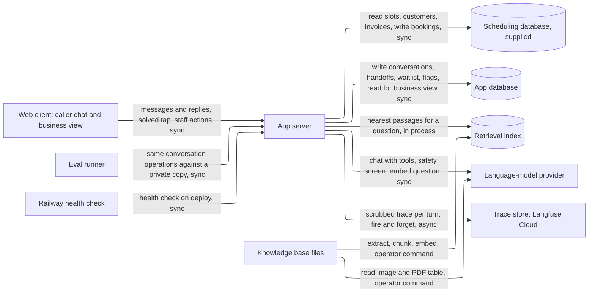
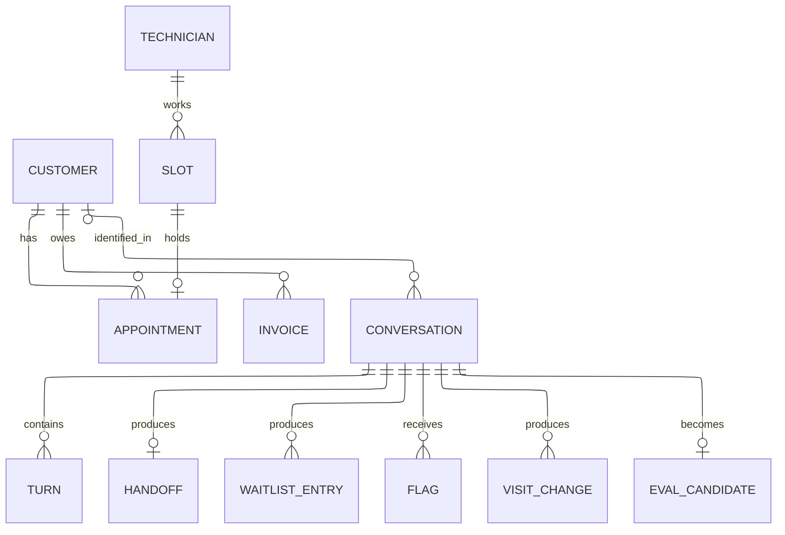
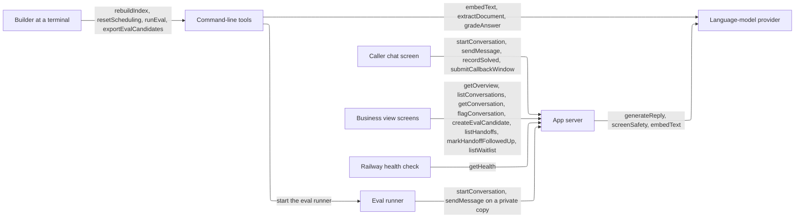

# HIGH_LEVEL_DESIGN.md — Meridian AI Call Agent

**What this document is.** The parts the system needs and why, sized to the load it actually has. It names kinds of component, not products; `STACK.md` picks the products. How the code is organized inside the app is `ARCHITECTURE.md`'s. Requirement IDs refer to `REQUIREMENTS.md`; metric names to `KEY_METRICS.md`; call numbers to `AUDIT.md`. **[assumed]** marks a number taken without confirmation; each is listed in §7.

## Summary

- **Load:** one builder plus a reviewer, up to 5 conversations at once (SC-1); live peak about 0.3 turns/s. The heaviest job is the eval run: 31 scenarios, about 250 turns, in about 6 minutes. Reads to writes about 2:1. About 10 MB of data in total.
- **Design:** one app server that runs the conversation, backed by the supplied scheduling database, a second small database for everything the app records, an in-process retrieval index built from the knowledge base, and an outside language-model provider.
- **Wireframe:** [Meridian Agent Wireframe](https://claude.ai/artifact/JY5CoLpz2ViQzaD8sMQ7Sa), clickable. Caller chat: start, loading, booking, wants earlier, waitlisted, confirmed, answer, handoff, safety stop, error, thanks and not-solved. Business view: overview, handoffs, waitlist, conversations.
- **Next as it grows:** final at this scale. The load is capped by SC-1 and the deadline of 2026-11-05 (DP-2); nothing in §2 comes within 100× of what one server and one database handle.
- **Cost:** hosting $5 to $10 through 2026-11-05; model use about $20 to $45 across the build, the larger part (`STACK.md`). Budget: no cap (GC-3), a banner at $100 (CO-1), which the build should stay under.

## 1. Sizing answers

| # | Question | Answer | Source |
|---|---|---|---|
| 1 | Users now, growth, peak | The reviewer, one tester and the eval harness; 5 conversations at once at most; no growth. Live until 2026-11-05. | SC-1, DP-2, GC-7 |
| 2 | Read- or write-heavy | Mixed, slightly read-heavy: each turn reads customer, slots, invoices and knowledge-base passages, and writes a log row (2:1). The heaviest interaction is the eval run, not a caller. | §2 |
| 3 | Data that can never be lost | Bookings (slot and appointment), handoff and callback requests, waitlist entries. Conversation logs are kept because the metrics and the eval loop depend on them. | RL-2, DE-2, FR-4, FR-1.15, OB-1 |
| 4 | Latency expected | First reply 6 s, a turn that writes a booking 10 s, business pages 2 s. | PF-1, PF-2, OB-2 |
| 5 | Cost ceiling | No cap in the app; a banner at $100 cumulative; the gateway key's own $250 limit. | GC-3, CO-1 |

## 2. Interactions and load

| # | Interaction | R/W | How often | Peak/s | Expected latency | Data touched | Can be lost? | Source |
|---|---|---|---|---|---|---|---|---|
| I-1 | Caller sends a message and gets a reply | R+W | 8 turns a conversation [assumed] | 0.3 live, 0.7 in eval | 6 s first reply | Conversation, Turn, Customer, Slot, Invoice, Passage | Log: no | FR-1, FR-2, FR-3, PF-1 |
| I-2 | Book, move or cancel a visit (inside a turn) | W | about 1 in 3 conversations | 0.1 | 10 s | Slot, Appointment | Never | FR-1.10 to 1.12, PF-2, VR-6 |
| I-3 | Join the waitlist (inside a turn) | W | about 1 in 12 conversations (34 of 420 calls, `AUDIT.md`) | below 0.05 | 10 s | WaitlistEntry | Never | FR-1.15 |
| I-4 | Hand off and take a callback window | W | about 1 in 4 (119 of 420 calls need a person or a safety stop, `AUDIT.md` §3) | 0.1 | 3 s | Handoff | Never | FR-4, FR-3.5 |
| I-5 | Caller taps solved or not | W | once per contained conversation | below 0.05 | 1 s | Conversation | Log: no | FR-5.6 |
| I-6 | Start a new conversation | W | each conversation | 0.05 | 1 s | Conversation | Log: no | FR-5.2 |
| I-7 | Staff opens the overview | R | a few times a day; refresh every 30 s | 0.05 | 2 s | Conversation, Turn, Appointment, Slot | — | FR-5.3, OB-2 |
| I-8 | Staff works the handoff queue and waitlist | R+W | a few times a day | below 0.05 | 1 s | Handoff, WaitlistEntry | Never | FR-5.5, FR-5.7 |
| I-9 | Staff browses, flags, or turns a conversation into a test | R+W | a few times a day | below 0.05 | 1 s | Conversation, Turn, Flag | Never | FR-5.4, OB-4 |
| I-10 | Eval run | R+W | several times before the deadline | 0.7 turns | whole run 6 min | Scenarios, a private copy of the scheduling data | — | EV-7, SC-1 |
| I-11 | Rebuild the retrieval index | R+W | when a knowledge-base file changes | n/a | 5 min | Passages | No | CH-1 |
| I-12 | Reset scheduling data to the seed | W | before each eval or demo | n/a | 1 min | Scheduling database | — | DP-4 |
| I-13 | Health check | R | on each deploy | n/a | 1 s | none | — | DP-2 |

**Arithmetic.**
- *Live peak:* 5 conversations (SC-1), a caller turn every 15 s [assumed] → 5 ÷ 15 = 0.33 turns/s. Business view: 2 viewers refreshing every 30 s = 0.07 requests/s.
- *Eval run:* 31 key scenarios (EV-1) × 8 turns = 248 turns. At about 6 s a turn, serial time is 1,488 s (25 minutes); 4 conversations at once (SC-2) take about 6 minutes, which is 248 ÷ 372 s ≈ 0.7 turns/s. The retrieval eval (20 questions, EV-4) needs only embeddings and is separate.
- *Storage:* a stored conversation is 8 turns × about 3 KB (including tool results and retrieved text for VR-9) ≈ 24 KB. 6 eval runs (186 conversations) plus 200 live ≈ 400 conversations ≈ 10 MB at most. Scheduling data 114 KB. Retrieval index: about 40 passages × 3 KB of vector ≈ 0.2 MB [assumed]. No uploaded files.
- *Outside calls per turn:* about 3 model calls (safety screen, answer with tool use, sometimes a second tool round) plus 1 question embedding [assumed]. Per eval run: 248 turns × 3 ≈ 750 model calls. At about 5,000 input tokens each, that is about 3.7 million input tokens a run; at the chosen models' prices (`STACK.md`: $0.50 in and $3 out per million for the agent, a cheaper model for the screen), about $2.50 to $4 a run including thinking output. This, not the servers, is the cost and latency driver.

Peak load is under 2 requests/s even in the eval run, and most of each turn is waiting on the model provider. One app server and one small database handle this with over 100× headroom.

## 3. Core entities

| Entity | What it is | Key attributes | Relations | Durability | Growth |
|---|---|---|---|---|---|
| Customer | Supplied account | name, phone, city, tier, brand | has Appointments, Invoices | supplied, restorable by DP-4 | none (154) |
| Technician | Supplied | skills, home zone | works Slots | supplied | none (8) |
| Slot | Supplied time window per technician, date, service type | date, window, zone, service type, status | holds 0..1 Appointment | never lose | none (528) |
| Appointment | A booked visit | slot, customer, issue, status | one Slot, one Customer | never lose | up to about 1 a conversation |
| Invoice | Supplied bill | amount, balance, line items | one Customer | supplied | none (81) |
| Conversation | One chat from first message to end | outcome, intent, cost, solved answer, matched customer | many Turns | never lose | 400 |
| Turn | One caller message and agent reply | text, the raw model reply (including its reasoning notes, replayed unchanged on the next turn), latency, tools called, retrieved passages, error | one Conversation | never lose | 3,200 |
| Handoff | A person must act: handoff, supervisor callback or safety stop | kind, reason, intent, what the caller was told, caller identity, preferred window, status, each a separate field | one Conversation, at most one per conversation | never lose | about 100 |
| WaitlistEntry | A caller wants an earlier window than the one booked | visit type, zone, a copy of the window held (date, window, zone); no status, because nothing in the requirements closes an entry | one Conversation | never lose | about 35 |
| Flag | A person marked a conversation wrong or poor | note, when (no author: nobody signs in) | one Conversation | never lose | tens |
| VisitChange | Audit row for each book, move or cancel the app committed | action, appointment, slot, confirmed date, window and technician | one Conversation | never lose | up to about 1 a conversation |
| EvalCandidate | A draft test scenario made from a logged conversation | scenario id, draft scenario | one Conversation | never lose | tens |
| Passage | A chunk of one current knowledge-base file | text, source file, vector | one source file | rebuildable (CH-1) | about 40 |
| Scenario and Eval result | Eval inputs and outputs, kept as files in the repository | expected outcome, facts, database change | none | never lose (version control) | 31 scenarios |

Customer, Technician, Slot, Appointment and Invoice live in the supplied scheduling database and keep its schema exactly (GC-6, CT-1). Everything else lives in the app database, so resetting to the seed (DP-4) never erases the logs.

**Access patterns**

| Read | Entities combined | How | At this scale |
|---|---|---|---|
| Find open windows (I-1, I-2) | Slot, Technician | filter by zone, service type, date range and status (members also see member-reserved), sort by date | fine as a query (528 rows) |
| Match the caller (I-1) | Customer | exact match on name plus phone, account number or address | fine as a query (154 rows) |
| Balance and line items (I-1) | Customer, Invoice | filter by customer | fine as a query |
| Answer a policy question (I-1) | Passage | nearest passages to the question's meaning, from current files only | needs a different kind of store: a meaning-based index (PRD-2, EV-4 require retrieval evaluated alone); 40 passages, searched in memory |
| Overview numbers (I-7) | Conversation, Turn, Appointment, Slot | counts by outcome over 7 days, p95 latency, a join to check booking agreement | fine as a query (400 conversations); computed on request, which meets the 1 minute lag (OB-2) with no stored counts |
| Handoff queue, waitlist (I-8) | Handoff, WaitlistEntry | filter by status, sort by age | fine as a query |
| Conversation list and detail (I-9) | Conversation, Turn | filter by outcome, sort by time | fine as a query |

## 4. API operations

Grouped by the component that **serves** each operation, with who **calls** it. Routes are sketches; exact contracts are `ARCHITECTURE.md`'s.

### 4.1 App server

| Operation | Called by | Input | Output | R/W | Latency class | Sync / async | Serves |
|---|---|---|---|---|---|---|---|
| `startConversation` — `POST /conversations` | Caller chat screen, Eval runner | nothing | conversation id, greeting | W | ≤ 1 s | sync | I-6, FR-5.2 |
| `sendMessage` — `POST /conversations/{id}/messages` | Caller chat screen, Eval runner | text; `simulateOutage` (honoured only when the demo fault setting is on) | reply, status (active, handed off, safety stop, ended), banner, quick-reply choices, booking card, actions | R+W | ≤ 6 s first reply, ≤ 10 s when it writes | sync; the booking, move, cancel, waitlist and handoff writes are saved before the reply says they happened | I-1 to I-4, FR-1 to FR-4 |
| `recordSolved` — `POST /conversations/{id}/solved` | Caller chat screen | yes or no | saved | W | ≤ 1 s | sync | I-5, FR-5.6 |
| `submitCallbackWindow` — `POST /conversations/{id}/callback-window` | Caller chat screen | morning, afternoon or evening | saved | W | ≤ 1 s | sync | I-4, FR-3.5, FR-4.3 |
| `getOverview` — `GET /overview` | Business view screens | window (7 days) | the success metric, three supporting metrics, six guarantee metrics, recent conversations, 24 h latency series | R | ≤ 2 s | sync | I-7, FR-5.3, `KEY_METRICS.md` |
| `listConversations` — `GET /conversations` | Business view screens | outcome filter | list | R | ≤ 1 s | sync | I-9 |
| `getConversation` — `GET /conversations/{id}` | Business view screens | id | turns, tools called, outcome, cost | R | ≤ 1 s | sync | I-9 |
| `flagConversation` — `POST /conversations/{id}/flag` | Business view screens | note | saved | W | ≤ 1 s | sync | FR-5.4 |
| `createEvalCandidate` — `POST /conversations/{id}/eval-candidate` | Business view screens | id | candidate row saved; the export command writes the file | W | ≤ 1 s | sync | OB-4 |
| `listHandoffs` — `GET /handoffs` | Business view screens | status filter | list | R | ≤ 1 s | sync | I-8, FR-5.5 |
| `markHandoffFollowedUp` — `POST /handoffs/{id}/followed-up` | Business view screens | id | saved | W | ≤ 1 s | sync | I-8, FR-5.5 |
| `listWaitlist` — `GET /waitlist` | Business view screens | none | list | R | ≤ 1 s | sync | I-8, FR-5.7 |
| `getHealth` — `GET /health` | Railway's health check | none | ok | R | ≤ 1 s | sync | I-13, DP-2 |
| `resetScheduling`, `rebuildIndex` — `POST /admin/reset-scheduling`, `POST /admin/rebuild-index` | Builder (fallback when shell access fails) | admin token | as the commands in §4.2 | W | as §4.2 | sync | I-11, I-12 |
| `listEvalCandidates` — `GET /admin/eval-candidates` | `exportEvalCandidates` | admin token | candidate scenarios | R | ≤ 1 s | sync | OB-4 |

**Inside the app server (no caller):**

| Work | Trigger | Does | Serves |
|---|---|---|---|
| Load the retrieval index | process start | reads the built index into memory | I-1, FR-2 |
| Close idle conversations | each `startConversation`, `getOverview` and `listConversations` | sets the outcome on conversations idle past a set time | OB-1 |
| Check booking agreement and spend | each `getOverview` | joins appointments to slots; spend comes from the model gateway's key usage so eval runs and the document read count (CO-1) | KEY_METRICS booking mismatches, total model spend |

### 4.2 Command-line tools (same codebase, run by the builder)

| Operation | Called by | Input | Output | R/W | Latency class | Sync / async | Serves |
|---|---|---|---|---|---|---|---|
| `rebuildIndex` | Builder | the knowledge-base folder | new retrieval index | W | ≤ 5 min | sync | I-11, CH-1 |
| `resetScheduling` | Builder | none | scheduling database back to the seed, waitlist and logs untouched | W | ≤ 1 min | sync | I-12, DP-4 |
| `runEval` | Builder | scenario set | per-scenario results, projected containment, accuracy, escalation, run environment record | R+W | ≤ 15 min | sync, 4 conversations in parallel against a private copy of the scheduling data | I-10, EV-3, EV-7, DE-3 |
| `exportEvalCandidates` | Builder | flagged conversations | scenario files | W | ≤ 1 min | sync | OB-4 |

### 4.3 External services

| Operation | Called by | Input | Output | Latency class | Serves |
|---|---|---|---|---|---|
| `generateReply` (chat model with tool use) | App server (`sendMessage`) | conversation, retrieved passages, tool results | reply or tool request | seconds | I-1 |
| `screenSafety` (small model check on every caller message) | App server (`sendMessage`) | message and recent turns | safe, burning-smell follow-up, or emergency | 1 to 3 s | FR-1.1, FR-1.2 |
| `embedText` | App server (`sendMessage`), `rebuildIndex` | question or passage | vector | under 1 s | FR-2, EV-4 |
| `extractDocument` (read the holiday image and fee table) | `rebuildIndex` | image, PDF | text | seconds, once per build | FR-2.3, FR-2.4 |
| `gradeAnswer` | `runEval` | expected facts, actual reply | verdict | seconds | EV-5 |
| `sendTrace` (fire and forget) | App server (`sendMessage`) | one trace per turn: spans for the safety screen, model calls and tool calls, with scrubbed text, ids, timings, tokens and cost | trace id, or nothing on failure | background, never waited on | OB-1, CP-1 |

## 5. Components

### Web client

**Why it exists:** callers use a chat in a browser at a public URL with no login (GC-5, FR-5.1), and staff need a view of how the agent is doing (FR-5.3). **Wireframe:** [Meridian Agent Wireframe](https://claude.ai/artifact/JY5CoLpz2ViQzaD8sMQ7Sa). **Provided by platform:** static files are served by the app server.

**Caller chat**
- **Start:** greeting, quick-reply chips, a text box, a "New conversation" button that clears identity (FR-5.2).
- **Loading:** a "looking that up" bubble while the reply is on its way.
- **Booking:** safety question, identification, window buttons including "Nothing earlier? Ask for an earlier window".
- **Wants earlier / Waitlisted:** book the later slot only, book and join the waitlist, or talk to a person; the confirmation says the team will call if an earlier window opens.
- **Confirmed:** date, window, technician, $89 diagnostic fee; then "Did this solve it?" (FR-5.6).
- **Answer:** a short policy answer with the same "Did this solve it?" prompt.
- **Handoff:** a banner that a person takes over, a morning, afternoon or evening picker, then the conversation ends.
- **Safety stop:** a red banner telling the caller to leave and call 911; the conversation ends.
- **Error:** a plain apology and the offer of a person; no stack trace (DE-1).
- **Thanks / not solved:** the saved answer and a button for a new conversation.

**Business view**
- **Overview:** status strip (public URL, last conversation, errors in 24 h, handoffs waiting); the success metric with a 7-day line against the 60 to 75% band; the three supporting metrics; "what just happened"; the guarantee measures with limits and a 24 h first-reply line. The wireframe's 24 h ping strip is dropped with the uptime monitor (builder, 2026-10-19).
- **Handoffs:** each row shows caller, why, what was said, and preferred window, with "mark followed up".
- **Waitlist:** caller, visit type, zone, the later window held, time waiting.
- **Conversations:** list, transcript, tools called, cost, "flag as wrong" with a note, "turn into a test scenario".

### App server

**Why it exists:** something must run the conversation, call the model, read and write the scheduling data, and serve the screens. The 2 requests/s peak (§2) needs one process. **Holds / does:** the conversation loop with the safety screen first on every message (Decision 2); retrieval from current documents only; the scheduling, billing, handoff and waitlist actions; the log of every turn; the business-view queries. **Provided by platform:** HTTPS, a public URL, restarts. A host that keeps a persistent disk across deploys is required (§7).

### Scheduling database

**Why it exists:** the PRD and GC-6 fix the supplied SQLite scheduling data as the place bookings are written, and the reviewer queries the same data. **Holds:** the five supplied tables, unchanged (CT-1). **Provided by platform:** a persistent disk. Writes commit before the reply says "booked" (RL-2, DE-2); two callers racing for a slot are serialized by the app: each book, move and cancel is one locked transaction that changes the slot only if it is still open, because the supplied schema has no unique rule to stop a double booking and CT-1 forbids adding one (RL-1). **Backup:** a copy before each eval run and a seed to restore from (DP-4); a booking is acknowledged only after it is committed on disk.

### App database

**Why it exists:** conversations, handoffs, waitlist entries, and flags need a durable home that DP-4 does not erase and the reviewer's schema checks (CT-1) do not see. **Holds:** the entities marked in §3 as app-owned. A relational database of the same kind fits the joins in §3 and keeps the whole system one engine. **Provided by platform:** persistent disk.

### Retrieval index

**Why it exists:** PRD-2 and EV-4 require retrieval over the knowledge base, evaluated on its own. The documents total about 20 KB and would fit in one prompt, so this box is justified by the requirement, not by size. **Holds:** passages and vectors for current documents, plus text read from the holiday image and the fee-schedule PDF; archive, old-copy and the 2024 scheduling guide are excluded as superseded, and agent-only files (`internal/`, `escalation_and_safety.md`, `technician_arrival_and_etas.md`) are left out of the index (FR-2.2, FR-2.7). In memory in the app, rebuilt by one command (CH-1). **Provided by platform:** no.

### Language-model provider

**Why it exists:** the agent reasons and writes the replies; also screens for safety, embeds text and grades evals. Seconds per call, so it dominates latency (PF-1) and cost (§6). Any paid provider is from the approved list (GC-4). **Provided by platform:** the provider's own availability; a failure becomes the plain message and offer of a person within 15 s of the turn starting, with a "still working" note from 10 s (DE-1).

### Eval runner

**Why it exists:** EV-3 to EV-7 need the eval run from one command. **Holds / does:** loads scenarios, starts a private copy of the app against a copy of the scheduling data so the live bookings are not touched, plays each scenario (4 at once), grades and prints per-scenario results and the projected containment. Not user-facing.

### Trace store

**Why it exists:** a reviewer or the builder needs to see what happened inside one turn: the safety screen, each model call and each tool call, with timings, tokens and cost (OB-1, FR-5.3). The app's own tables stay the source of truth; the trace store sits beside them and replaces nothing. Traces carry only text with card-shaped strings removed (CP-1). Sending is fire-and-forget, so an outage there never delays or fails a turn. **Provided by platform:** Langfuse Cloud, US region, Hobby free tier (`STACK.md` §17).

No uptime checker and no alert webhook (builder, 2026-10-19): Railway's health check and restart cover DP-2, and the business view's banner covers CO-1.

**What to add next**

Final at this scale: capped at 5 simultaneous conversations (SC-1) for a review window ending 2026-11-05 (DP-2). No queue (the longest operation is a 10 s turn), cache (every read is under 10 ms), scheduler (the two periodic checks run when someone opens the overview), second instance, load balancer, object storage or CDN is justified. The first thing that will strain is the model provider's rate limit during a 4-way eval run; if `runEval` logs rate-limit errors, lower the parallelism rather than add a component.

## 6. Cost envelope

| Component | Now (build) | At horizon (2026-11-05) |
|---|---|---|
| App hosting: one small always-on instance with a disk | $5 to $10 | same |
| Scheduling and app databases | in the disk | in the disk |
| Retrieval index and embeddings | under $1 | under $1 |
| Trace store (Langfuse Cloud Hobby) | $0 (free tier) | $0 |
| Model provider, live traffic (a few hundred conversations) | $5 to $10 | same |
| Model provider, eval runs: about $2.50 to $4 each, 4 to 6 runs, plus prompt tuning | $15 to $35 | same |
| **Total** | **about $30 to $55 over the build** | **same** |

No cap (GC-3). The CO-1 banner at $100 should not show on this plan; it could only in a worst case of many long eval runs or abuse of the public URL (about $100 to $150). Exact prices are in `STACK.md`.

## 7. Open questions and upstream fixes

| Item | Why it matters | Resolved by |
|---|---|---|
| [assumed] 8 turns a conversation, a caller turn every 15 s, 3 model calls and 1 embedding a turn | Sets the eval length and the cost | First prototype run; replace with measured values in `STACK.md` and `ARCHITECTURE.md` |
| [assumed] 4 conversations in parallel finish the eval in about 6 minutes | Needs the provider's rate limits to allow it, and the private database copy | **SC-2** in `REQUIREMENTS.md` (applied) |
| [assumed] 5,000 input tokens a call | One eval run costs about $2.50 to $4 at the chosen prices | Measured on the first prototype run; prices are in `STACK.md` |
| The waitlist lives in the app database, not "beside the supplied tables" as A14 and DP-4 say | Keeps the supplied schema untouched and the reset from erasing logs | Reword A14 and DP-4 in `REQUIREMENTS.md` (applied with this document) |
| FR-5.5 lists handoffs but gives staff no way to close them; the callback window is chosen with buttons | The wireframe needs `markHandoffFollowedUp` and `submitCallbackWindow` | Reword FR-5.5, FR-3.5 and FR-4.3 in `REQUIREMENTS.md` (applied with this document) |
| DP-2 said an external ping is logged | The builder dropped the uptime monitor and its ping log (builder, 2026-10-19) | DP-2 reworded |
| The host must keep the disk across deploys, and each deploy must not run the seed reset | A redeploy that wipes the disk would lose acknowledged bookings | `STACK.md` host choice; `ARCHITECTURE.md` start-up rule |
