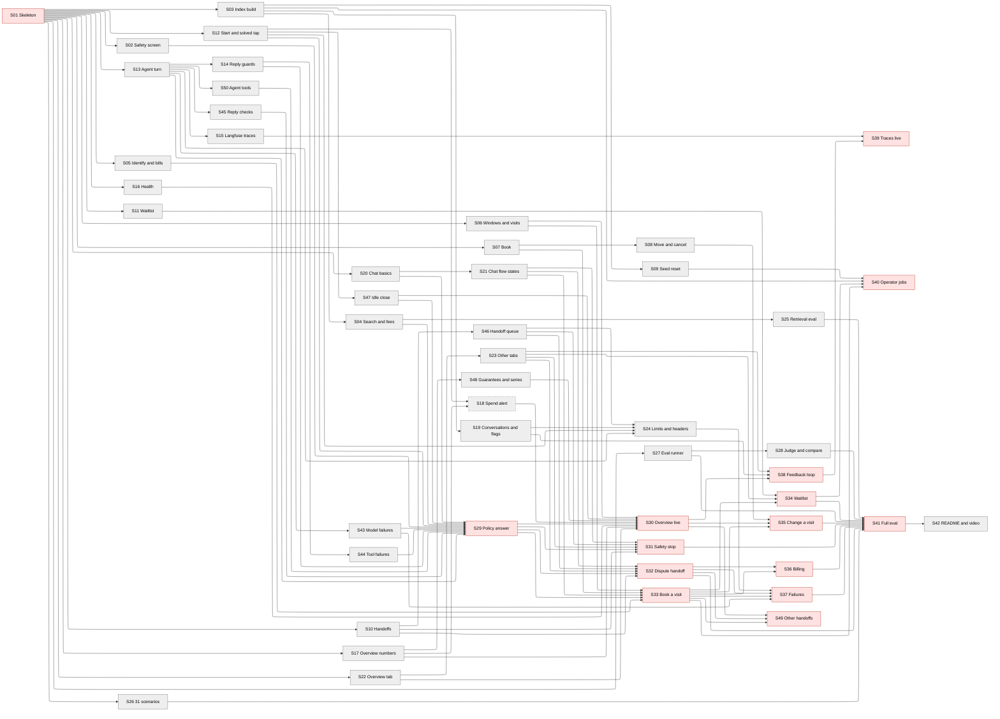

# Story map — Meridian AI Call Agent

Written 2026-10-18 with the story-writer skill from `USERS.md`, `REQUIREMENTS.md`, `KEY_METRICS.md`, `HIGH_LEVEL_DESIGN.md`, `STACK.md`, `ARCHITECTURE.md`, `AUDIT.md`, `USERS_handoff.md` and the [Meridian Agent Wireframe](https://claude.ai/artifact/JY5CoLpz2ViQzaD8sMQ7Sa). It replaces the earlier 16-story set. Two fresh review agents checked it in turn; their findings are fixed, decided by the builder on 2026-10-19, or listed under Blockers.

Arrows point from a story to the stories it unblocks. Red = human demo (story 1 and wiring stories); grey = module story checked by agents. Dashed border = planning waits on a blocker below.
Demo order: S01 → S29 → S30, S31, S32, S33 together → S34, S35, S36, S37, S38, S49 together → S39, S40, S41 together.

**Following the wireframe.** Every screen matches the wireframe exactly in these respects:
- the layout and order of parts;
- every button, chip, banner, tile, chart and table label;
- the banner colours: amber for "Passed to a person" and "Something went wrong on our side", red for the safety stop;
- the fixed texts.

Each `[placeholder]` is filled from the database or the knowledge base. Wireframe-only parts are dropped: the "preview a state" buttons, the "(example data)" labels, "All numbers on this page are example data.", and "Wireframe. Names, dates and technicians are [placeholders]." in the footer. Both pages work at 390 px wide, a common phone width **[assumed]**, with no sideways scroll. Criteria tagged `wireframe` name the state they must match.

Additions approved by the builder:
- **2026-10-18:** an "Open trace" link per turn in the conversation detail (S23, S39).
- **2026-10-19:** a "Conversations by day and outcome" block (S22-10), the zone on waitlist rows (S23-4), "after an error" on failure-driven handoff rows (S23-9), a safety-stop mark (S23-3), a spend banner (S22-6), "Diagnostic fee waived for members" on a member's card (S35-2), and the turn-cap text (S24-3, S37-5).

| Wireframe state | Built (module) | Shown on real data (wiring) |
|---|---|---|
| Caller: Start, chips, New conversation | S20 | S29, S36 |
| Caller: Loading, "still working" | S20 | S29 |
| Caller: Answer, "Did this solve it?", Thanks, Not solved | S20 | S29 |
| Caller: Booking window buttons, Confirmed | S21 | S33 |
| Caller: Wants earlier, Waitlisted | S21 | S34 |
| Caller: Handoff banner and call-back picker | S21 | S32, S49 |
| Caller: Safety stop | S21 | S31 |
| Caller: Error and the "Simulate an outage" chip | S21 | S37 |
| Business: title, tabs, empty panels | S01 | S30 |
| Business: Overview tab | S22 | S30 |
| Business: Handoffs tab | S23 | S31, S32 |
| Business: Waitlist tab | S23 | S34 |
| Business: Conversations tab | S23 | S38 |
| Business: "Open trace" link (addition) | S23 | S39 |

## Blockers
| # | Blocks stories | What is needed | Who decides | Source |
|---|---|---|---|---|
| 1 | S18 (criteria 4, 6, 7), S30 (criterion 5) | The Slack or Discord incoming webhook the alerts post to | the builder | `ARCHITECTURE.md` open question 15 |
| 2 | S01, S02, S15, S30 | The external accounts and keys in "External wait" below, before each story starts | the builder | `STACK.md` → Prerequisites |

Decided on 2026-10-19 by the builder:
- **The seven wireframe additions** are approved: volume block, waitlist zone, "after an error", safety-stop mark, spend banner, member fee line, and the turn-cap text "This conversation has reached its limit. Please start a new conversation, or ask for a call back." They are now in `ARCHITECTURE.md` (Design tradeoffs, row 2).
- **Eval runs are reported to Langfuse as experiments** (S27-8, S41-11; Design tradeoffs, row 3).
- **FR-2.6's "two documents disagree" case is an accepted gap.** No two current documents disagree, so no demo can show it; the "documents do not settle it" half is S49-2.

No deadline is at risk or missed.

## Order
| # | Story | Kind | Blocked by | Review gate | Size | Checked by (command, or demo in one line) |
|---|---|---|---|---|---|---|
| S01 | [The app runs at its public URL with every part stubbed](S01-walking-skeleton.md) | skeleton | none | human demo | L | The public URL loads, every stub answers, CI is green, the dashboard shows 10 empty panels |
| S02 | [Remove card numbers and screen every message for danger](S02-safety-screen-and-card-scrub.md) | module | S01 | agents | L | Unit tests on `redactCardNumbers`. Scenario tests on `screenSafety` against the real safety model, plus one with the provider faked to fail. A log search after the tests. |
| S03 | [Build the search index from the approved-file list](S03-knowledge-index-build.md) | module | S01 | agents | L | Run the extract and rebuild commands on the supplied knowledge base and list the resulting passages. Call the admin route with and without the token. Tests with fake embeddings for the failure cases. |
| S12 | [Start a conversation and take the caller's solved tap](S12-conversation-start-solved-idle.md) | module | S01 | agents | M | Route and interface tests against a temporary app database. |
| S13 | [Answer a message with the model, replaying the conversation exactly](S13-run-a-turn.md) | module | S01 | agents | L | Route tests with the other modules stubbed: most use the scripted fake model, and two use the real agent model. |
| S20 | [The chat screen: start, loading, answer and the solved tap](S20-chat-screen-basics.md) | module | S01 | agents | M | Browser tests (Playwright) of the page against the contract stubs, reading the rendered text. |
| S47 | [Give every abandoned conversation an outcome](S47-close-idle-conversations.md) | module | S12 | agents | M | Interface tests against a temporary app database with the clock moved past the idle limit. |
| S04 | [Search current documents and read firm fees](S04-knowledge-search-and-fees.md) | module | S03 | agents | M | Tests against an index built from the supplied knowledge base with the real embeddings, and against a missing index and failing embeddings. |
| S14 | [Nothing is offered or written before the screen says safe and the caller says yes](S14-guard-every-reply.md) | module | S13 | agents | M | Turn tests with a scripted fake model and stubbed modules, each forcing one rule. |
| S50 | [Give the model its tools, with the account always taken from the conversation](S50-agent-tools.md) | module | S13 | agents | M | Turn tests with a scripted fake model calling each tool, and recording stubs for Knowledge, Scheduling and Follow-ups. |
| S43 | [A failing model still gets an answer to the caller in time](S43-fail-safely-within-the-deadline.md) | module | S13 | agents | M | Turn tests with the scripted fake model set to hang, fail with each error, or reject a replay, and with the app database faked to fail. |
| S45 | [Check what a reply says before the caller sees it](S45-check-what-a-reply-says.md) | module | S13 | agents | M | Turn tests with a scripted fake model and stubbed modules, each forcing one rule. |
| S44 | [A failing screen, search or booking never reaches the caller as an error](S44-fail-safely-when-a-tool-fails.md) | module | S14 | agents | S | Turn tests with a scripted fake model and each stub set to fail. |
| S05 | [Identify a caller and read only their own bill](S05-identify-callers-and-read-bills.md) | module | S01 | agents | M | Tests against a temporary copy of the supplied scheduling database. |
| S06 | [Find open windows and the visits on file](S06-open-windows-and-visits.md) | module | S01 | agents | M | Tests against a temporary copy of the supplied scheduling database, with the reference date changed in one, and with an unreadable copy in another. |
| S07 | [Book a visit in one locked step](S07-book-a-visit.md) | module | S01 | agents | M | Tests against a temporary copy of the supplied database, including two gate tests that race and interrupt bookings. |
| S21 | [The chat screen: booking, waitlist, handoff, safety and error states](S21-chat-screen-flow-states.md) | module | S20 | agents | M | Browser tests (Playwright) of the page, each with the reply stub returning one contract-shaped reply. |
| S10 | [Record a handoff and take the caller's call-back window](S10-handoffs-and-callback-windows.md) | module | S01 | agents | M | Route and interface tests against a temporary app database, with `endWithHandoff` stubbed. |
| S46 | [Let staff list open handoffs and mark them followed up](S46-staff-handoff-queue.md) | module | S10 | agents | M | Route tests against a temporary app database seeded with handoffs. |
| S23 | [The business view's Handoffs, Waitlist and Conversations tabs](S23-handoffs-waitlist-conversations-tabs.md) | module | S22 | agents | M | Browser tests (Playwright) of each tab against stubbed lists. |
| S16 | [Answer the uptime check and record each ping](S16-health-and-pings.md) | module | S01 | agents | M | Route tests against a temporary app database with the status interfaces stubbed. |
| S17 | [Compute the business view's success and supporting numbers](S17-overview-numbers.md) | module | S01 | agents | M | Route tests on a temporary app database seeded with synthetic conversations, turns, handoffs, flags and audit rows. |
| S48 | [Check the promises and draw the last 24 hours](S48-overview-guarantees-and-series.md) | module | S17 | agents | M | Route tests on a temporary app database and scheduling copy seeded with synthetic turns, pings and audit rows. |
| S18 | [Read total spend and alert once when it passes $100](S18-spend-and-alert.md) | module | S12, S17 | agents | L | Tests with a fake key-usage reader and a webhook recorder. One check against the real key usage, and one against a real failed deploy. |
| S22 | [The business view's Overview tab](S22-overview-tab.md) | module | S01 | agents | M | Browser tests (Playwright) of the tab against a stubbed overview with fixed numbers. |
| S08 | [Move or cancel a visit and free the old window](S08-move-and-cancel-a-visit.md) | module | S07 | agents | M | Tests against a temporary copy of the supplied database, one with the reference clock moved to 2026-10-21 12:00. |
| S09 | [Restore the bookings to the supplied seed, with a backup first](S09-reset-scheduling-to-seed.md) | module | S03 | agents | M | Run the reset command on a copy after a test booking, then compare slot counts and table contents with the seed. |
| S11 | [Keep a waitlist for earlier windows](S11-waitlist.md) | module | S01 | agents | M | Interface and route tests against a temporary app database and a temporary scheduling copy. |
| S15 | [Send each turn to Langfuse as a scrubbed trace](S15-langfuse-traces.md) | module | S13 | agents | L | Turn tests with the scripted fake model: against a Langfuse test project for the first criterion, and against an in-memory trace recorder for the rest. |
| S19 | [List conversations, flag one and draft a test from it](S19-conversations-flags-and-drafts.md) | module | S03 | agents | M | Route tests on a temporary app database seeded with synthetic conversations, and a run of the export command against the test app. |
| S24 | [Abuse limits, security headers and five chats at once](S24-limits-and-security-headers.md) | module | S12, S13, S19, S46 | agents | M | Route tests with the caps set low, a header check on every page and route, and a gate test running five conversations against the fake provider. |
| S25 | [Measure retrieval alone with 20 questions](S25-retrieval-eval.md) | module | S04 | agents | M | Run the command against the index built from the supplied knowledge base and read the report. The gate runs the same questions with fake embeddings. |
| S26 | [Write the 31 test scenarios and the call-mix weights](S26-eval-scenarios.md) | module | S01 | agents | M | A file check over the scenario folder, and a read of the files against the call each names. |
| S27 | [Run the scenarios four at a time and write the run record](S27-eval-runner.md) | module | S01 | agents | L | Runs on two synthetic scenarios against the app with the fake model, and one run on a known RunResult fixture to check the summary arithmetic. |
| S28 | [Grade answers with a judge and compare two runs](S28-judge-and-compare.md) | module | S27 | agents | M | The judge on two fixed transcripts with the real judge model; the compare command on two fixture run records. |
| S29 | [Ask a policy question in the chat and get the current answer](S29-answer-a-policy-question.md) | wiring | S02, S04, S12, S13, S14, S20, S43, S44, S45, S47, S50 | human demo | M | "Is the diagnostic fee $79?" gets $89 on the real screen; Thanksgiving hours, the $149 after-hours fee and a price range follow |
| S30 | [See the business view on real conversations and real pings](S30-overview-on-real-data.md) | wiring | S29, S06, S16, S17, S18, S22, S47, S48 | human demo | M | The Overview shows real pings, settled calls, a new conversation within a minute, and one spend alert |
| S31 | [A gas smell stops the chat and shows up in the Handoffs tab](S31-safety-stop.md) | wiring | S29, S10, S46, S21, S23 | human demo | M | "I smell gas" shows the red banner, books nothing and appears in the Handoffs tab |
| S32 | [Hand a disputed charge to a supervisor with a call-back time](S32-handoff-and-callback.md) | wiring | S29, S10, S46, S21, S23 | human demo | M | "I was charged twice" gets a supervisor call-back for the afternoon, with the full story in the Handoffs tab |
| S33 | [Identify the caller and book a visit from the chat](S33-identify-and-book.md) | wiring | S29, S05, S06, S07, S21 | human demo | M | Omar Patel by account number books Wed 2026-10-21 8 to 12 with Jun Park; slot 115 is booked in the database; Sunday gets the nearest window |
| S38 | [Read a conversation, flag it, and turn it into a test](S38-conversations-and-feedback-loop.md) | wiring | S30, S19, S23 | human demo | M | A conversation is flagged, turned into a test, and exported into the repository |
| S34 | [Book the earliest window and join the waitlist](S34-join-the-waitlist.md) | wiring | S33, S11, S23 | human demo | S | "Nothing earlier?" books Wed 1 to 5 and adds one waitlist row, shown in the Waitlist tab |
| S35 | [Check, move or cancel a visit from the chat](S35-change-a-visit.md) | wiring | S33, S08, S30 | human demo | M | Linda Foster by address hears her visit, moves it and cancels free; Grace Okafor's next-morning cancel states $49 with no waiver |
| S36 | [Hear a balance and get a payment link, never give a card number](S36-billing-and-payment-link.md) | wiring | S33, S32 | human demo | M | Omar Patel hears $478.00, gets a payment link, and a card number is refused and kept nowhere |
| S37 | [When something breaks, the caller gets a clear message and a call back](S37-failures-and-fallbacks.md) | wiring | S32, S33, S24, S43 | human demo | M | "Simulate an outage" shows the error banner within 15 s and a call back lands in the Handoffs tab |
| S39 | [Open any turn's trace in Langfuse from the business view](S39-langfuse-traces-live.md) | wiring | S38, S15 | human demo | S | "Open trace" opens the turn's Langfuse trace; card numbers and an outage leave no mark |
| S49 | [Hand off whatever the agent should not answer itself](S49-other-handoff-reasons.md) | wiring | S32, S33, S30 | human demo | M | A refund, geothermal, auto-renew, a late technician, a new system, duct cleaning, a gas line, Manor and north plumbing each go to a person |
| S40 | [Reset the bookings and add a document on the deployed app](S40-operator-jobs-on-the-deployed-app.md) | wiring | S33, S34, S03, S09 | human demo | M | The live seed reset restores the slot counts; a new document answers after one rebuild |
| S41 | [Run all 31 scenarios and print the containment numbers](S41-full-eval-run.md) | wiring | S25, S26, S27, S28, S31, S32, S34, S35, S36, S37 | human demo | L | One command prints 31 results, projected containment, accuracy, escalation and zero Gate counters |
| S42 | [Write the README and record the walkthrough video](S42-readme-and-video.md) | module | S41 | agents | M | A README check against a list of required sections, a timed clone-to-run on a clean machine, and the video's length read from its file. The builder watches the video before it is submitted. |

## Timeline
Capacity: 5 stories built at once (the builder, 2026-10-18). Demos are watched as soon as each is ready (the builder, 2026-10-18), taken here as within 30 minutes between 08:00 and 22:00 Central **[assumed]**. Start: Sun 2026-10-18 18:00 Central, once this set is approved **[assumed]**.

Total: 565 – 1,170 agent minutes plus one 6 – 15 minute eval run. Last required demo: Mon 08:20 likely, Mon 13:10 high. Everything built and demoed by Mon 08:30 likely, Mon 13:30 high (S42's video adds about 1 hour of the builder's time after that). There are 15 demos of about 10 minutes each, in 5 rounds. Times come from a schedule that runs at most 5 stories at once, starts each one only after its blockers are done (a wiring blocker: demoed), and holds demos to 08:00 to 22:00.

| # | Story | Agent minutes (likely – high) | Built by (likely – high) | Demo done by (likely – high) | Needed for |
|---|---|---|---|---|---|
| S01 | Skeleton | 20 – 45 | Sun 18:20 – Sun 18:45 | Sun 18:30 – Sun 19:25 | GC-1 |
| S02 | Safety screen | 20 – 45 | Sun 18:50 – Sun 20:10 | — | GC-1 |
| S03 | Index build | 20 – 45 | Sun 18:50 – Sun 20:10 | — | GC-1 |
| S12 | Start and solved tap | 10 – 20 | Sun 18:40 – Sun 19:45 | — | GC-1 |
| S13 | Agent turn | 20 – 45 | Sun 18:50 – Sun 20:10 | — | GC-1 |
| S20 | Chat basics | 10 – 20 | Sun 18:40 – Sun 19:45 | — | GC-1 |
| S47 | Idle close | 10 – 20 | Sun 18:50 – Sun 20:05 | — | GC-1 |
| S04 | Search and fees | 10 – 20 | Sun 19:00 – Sun 20:30 | — | GC-1 |
| S14 | Reply guards | 10 – 20 | Sun 19:00 – Sun 20:30 | — | GC-1 |
| S50 | Agent tools | 10 – 20 | Sun 19:00 – Sun 20:30 | — | GC-1 |
| S43 | Model failures | 10 – 20 | Sun 19:00 – Sun 20:45 | — | GC-1 |
| S45 | Reply checks | 10 – 20 | Sun 19:00 – Sun 20:45 | — | GC-1 |
| S44 | Tool failures | 5 – 10 | Sun 19:05 – Sun 20:40 | — | GC-1 |
| S05 | Identify and bills | 10 – 20 | Sun 18:50 – Sun 20:05 | — | GC-1 |
| S06 | Windows and visits | 10 – 20 | Sun 19:10 – Sun 20:25 | — | GC-1 |
| S07 | Book | 10 – 20 | Sun 19:10 – Sun 20:25 | — | GC-1 |
| S21 | Chat flow states | 10 – 20 | Sun 19:10 – Sun 20:50 | — | GC-1 |
| S10 | Handoffs | 10 – 20 | Sun 19:10 – Sun 20:50 | — | GC-1 |
| S46 | Handoff queue | 10 – 20 | Sun 19:20 – Sun 21:10 | — | GC-1 |
| S23 | Other tabs | 10 – 20 | Sun 19:30 – Sun 21:25 | — | GC-1 |
| S16 | Health | 10 – 20 | Sun 19:15 – Sun 21:00 | — | GC-1 |
| S17 | Overview numbers | 10 – 20 | Sun 19:20 – Sun 21:05 | — | GC-1 |
| S48 | Guarantees and series | 10 – 20 | Sun 19:30 – Sun 21:25 | — | GC-1 |
| S18 | Spend alert | 20 – 45 | Sun 19:40 – Sun 21:55 | — | GC-1 |
| S22 | Overview tab | 10 – 20 | Sun 19:20 – Sun 21:05 | — | GC-1 |
| S08 | Move and cancel | 10 – 20 | Sun 19:20 – Sun 21:10 | — | GC-1 |
| S09 | Seed reset | 10 – 20 | Sun 19:25 – Sun 21:20 | — | GC-1 |
| S11 | Waitlist | 10 – 20 | Sun 19:30 – Sun 21:30 | — | GC-1 |
| S15 | Langfuse traces | 20 – 45 | Sun 19:45 – Sun 22:05 | — | GC-1 |
| S19 | Conversations and flags | 10 – 20 | Sun 19:40 – Sun 21:45 | — | GC-1 |
| S24 | Limits and headers | 10 – 20 | Sun 19:50 – Sun 22:05 | — | GC-1 |
| S25 | Retrieval eval | 10 – 20 | Sun 19:40 – Sun 21:45 | — | GC-1 |
| S26 | 31 scenarios | 10 – 20 | Sun 19:40 – Sun 21:50 | — | GC-1 |
| S27 | Eval runner | 20 – 45 | Sun 20:00 – Sun 22:30 | — | GC-1 |
| S28 | Judge and compare | 10 – 20 | Sun 20:10 – Sun 22:50 | — | GC-1 |
| S29 | Policy answer | 10 – 20 | Sun 19:50 – Sun 22:10 | Sun 20:00 – Mon 08:10 | GC-1 (answers first) |
| S30 | Overview live | 10 – 20 | Sun 20:10 – Mon 08:30 | Sun 20:20 – Mon 09:10 | GC-1 |
| S31 | Safety stop | 10 – 20 | Sun 20:10 – Mon 08:30 | Sun 20:30 – Mon 09:20 | GC-1 |
| S32 | Dispute handoff | 10 – 20 | Sun 20:10 – Mon 08:30 | Sun 20:40 – Mon 09:30 | GC-1 |
| S33 | Book a visit | 10 – 20 | Sun 20:10 – Mon 08:30 | Sun 20:50 – Mon 09:40 | GC-1 (booking first) |
| S38 | Feedback loop | 10 – 20 | Sun 20:30 – Mon 09:30 | Sun 21:00 – Mon 10:10 | GC-1 |
| S34 | Waitlist | 5 – 10 | Sun 20:55 – Mon 09:50 | Sun 21:10 – Mon 10:30 | GC-1 |
| S35 | Change a visit | 10 – 20 | Sun 21:00 – Mon 10:00 | Sun 21:20 – Mon 10:40 | GC-1 |
| S36 | Billing | 10 – 20 | Sun 21:00 – Mon 10:00 | Sun 21:30 – Mon 10:50 | GC-1 |
| S37 | Failures | 10 – 20 | Sun 21:00 – Mon 10:00 | Sun 21:40 – Mon 11:00 | GC-1 |
| S39 | Traces live | 5 – 10 | Sun 21:05 – Mon 10:20 | Sun 22:00 – Mon 11:20 | GC-1 |
| S49 | Other handoffs | 10 – 20 | Sun 21:00 – Mon 10:00 | Sun 21:50 – Mon 11:10 | GC-1 |
| S40 | Operator jobs | 10 – 20 | Sun 21:20 – Mon 10:50 | Mon 08:10 – Mon 11:30 | GC-1 |
| S41 | Full eval | 20 – 45, plus a 6 – 15 min eval run and 30 min of the builder's grading | Sun 22:06 – Mon 12:00 | Mon 08:20 – Mon 13:10 | GC-1 (eval numbers first) |
| S42 | README and video | 10 – 20 | Mon 08:30 – Mon 13:30 | — | GC-1 (deliverables) |

Dates move with the start time and with when each demo is watched. A demo left overnight moves every later round to the next morning; the high column already allows for one.

| External wait | Needed by story | Lead time | Start by |
|---|---|---|---|
| Railway Hobby account, a volume, backups on, "Wait for CI" on, an SSH key for `railway ssh`; GitHub Actions on the repository | S01 | minutes | now |
| OpenRouter account and key with the builder's Google key (BYOK); input and output logging off | S02, S03, S13 | minutes | now |
| The builder reads and corrects the text extracted from the holiday image and the fee PDF, and marks each checked | S03 | about 15 minutes of the builder's time | while S03 builds (Sun evening) |
| Langfuse Cloud project in the US region, its public and secret keys in Railway | S15 | minutes | before S15 starts (Sun evening) |
| A Slack or Discord incoming webhook (Blocker 1) | S18 | minutes | before S18 starts (Sun evening) |
| UptimeRobot monitor on `/health` every 5 minutes, email alerts on | S30 | minutes, then 15 minutes of pings | as soon as S01 is deployed |
| The builder grades the 10 handled-driver transcripts of S41's first run into `eval/human_grades.json` (EV-5) | S41 (criterion 3) | about 30 minutes of the builder's time, included in S41's demo time above | right after S41's first run |
| The builder reads 20 random calls and records agreement with the labels (EV-6) | S42 | about 30 minutes of the builder's time | any time before S42 |
| Recording the 3 to 4 minute video (the demo-video skill, ElevenLabs key) and the builder watching it | S42 | about 1 hour | after S41 |

| Deadline | Date | Requires | Stories | Done by (high) | Status |
|---|---|---|---|---|---|
| Deploy freeze (`STACK.md` §13): only fixes after it | evening of Tue 2026-10-20 | every feature deployed | S01 to S41, S43 to S50 | Mon 2026-10-19 13:10 (last demo, high) | met, about 1.2 days of margin |
| GC-1: deployed and reviewable, with the video and README | Wed 2026-10-21 11:59 PM Central | every Must and Gate row; GC-1's order if half done: booking, answers and eval numbers first | S01 to S50 | Mon 2026-10-19 about 14:30 (high, with the video) | met, about 2.4 days of margin |

GC-1's order holds: the policy answer (S29) is the first wiring demo, booking (S33) is in round 3 and depends on neither handoff nor monitoring, and the eval run (S41) follows as soon as every flow it plays has been demoed.

## Design tradeoffs
| # | Change | Documents changed | Rows checked (number, why it holds) | Saves | Cost later | Decision |
|---|---|---|---|---|---|---|
| 1 | `TurnView` gains `traceId`, so the conversation detail can link each turn to its Langfuse trace | `ARCHITECTURE.md` → Shared types (`TurnView`), PRD and wireframe coverage | OB-1: unchanged, the trace is extra; CP-1: the id is not caller text; AZ-1: the id names a trace, not an account. No row loses | Nothing; it closes a gap, not a deadline | None; the column already existed | approved by the builder on 2026-10-18 |

| 2 | Seven additions to the wireframe: the volume block, waitlist zone, "after an error", safety-stop mark, spend banner, member fee line and turn-cap text | `ARCHITECTURE.md` → PRD and wireframe coverage; Conversation → Must hold → Fixed texts | FR-5.3, FR-5.7, FR-5.8, FR-1.10, OB-3, CO-1 each become visible; no row loses | Nothing; it closes presentation gaps | Seven small screen elements | approved by the builder on 2026-10-19 |
| 3 | Eval runs are also reported to Langfuse as experiments (was optional) | `ARCHITECTURE.md` → Offline tools | DE-3: the run record stays the source of truth; EV-7: reporting is fire-and-forget, so the 15-minute limit holds | Nothing | One more Langfuse use; free-tier units (open question 14) | approved by the builder on 2026-10-19 |

No tradeoff is needed for the deadlines: both are met on the high estimate.

## Architecture coverage
| Element | Kind | ARCHITECTURE section | Owning story | Criterion | Extended by |
|---|---|---|---|---|---|
| `POST /conversations` (startConversation) | route | Conversation → API | S12 | S12-1 | S24 (cap), S43 (`demoFaults`), S47 (idle sweep) |
| `POST /conversations/:id/messages` (sendMessage) | route | Conversation → API | S13 | S13-1 | S14, S15, S24, S43, S44, S45, S50 |
| `POST /conversations/:id/solved` (recordSolved) | route | Conversation → API | S12 | S12-2 to S12-6 | — |
| `POST /conversations/:id/callback-window` (submitCallbackWindow) | route | Follow-ups → API | S10 | S10-3 to S10-6 | — |
| `GET /handoffs` (listHandoffs) | route | Follow-ups → API | S46 | S46-1, S46-2, S46-3 | — |
| `POST /handoffs/:id/followed-up` (markHandoffFollowedUp) | route | Follow-ups → API | S46 | S46-4, S46-5, S46-6 | S24 (cap) |
| `GET /waitlist` (listWaitlist) | route | Follow-ups → API | S11 | S11-3 | — |
| `GET /overview` (getOverview) | route | Monitoring → API | S17 | S17-1, S17-7 | S18 (spend), S48 (guarantees, series) |
| `GET /conversations` (listConversations) | route | Monitoring → API | S19 | S19-1, S19-9 | — |
| `GET /conversations/:id` (getConversation, with `traceId`) | route | Monitoring → API; Shared types | S19 | S19-2 | — |
| `POST /conversations/:id/flag` (flagConversation) | route | Monitoring → API | S19 | S19-3, S19-4 | S24 (cap) |
| `POST /conversations/:id/eval-candidate` (createEvalCandidate) | route | Monitoring → API | S19 | S19-5, S19-6 | S24 (cap) |
| `GET` and `HEAD /health` (getHealth) | route | Monitoring → API | S16 | S16-1, S16-2 | — |
| `GET /admin/eval-candidates` (listEvalCandidates) | route | Monitoring → API | S19 | S19-7 | — |
| `POST /admin/rebuild-index` | route | Knowledge → Jobs | S03 | S03-7 | — |
| `POST /admin/reset-scheduling` | route | Scheduling → Jobs | S09 | S09-5 | — |
| `GET /` caller chat: Start, Loading, Answer, Thanks, Not solved, New conversation | screen | Conversation → API (Pages); PRD and wireframe coverage | S20 | S20-1 to S20-8 | S21 |
| Caller chat: Booking, Wants earlier, Confirmed, Waitlisted, Handoff, Safety stop, Error | screen | PRD and wireframe coverage | S21 | S21-1 to S21-8 | — |
| `GET /business` Overview tab, 30-second refresh | screen | Monitoring → API (Pages) | S22 | S22-1 to S22-9 | S23 |
| Business view Handoffs, Waitlist and Conversations tabs, "Open trace" link | screen | PRD and wireframe coverage | S23 | S23-1 to S23-8 | — |
| `closeIdleConversations` (job and interface) | job | Conversation → Jobs, Interface | S47 | S47-1 to S47-5 | — |
| `checkSpendAlert` | job | Monitoring → Jobs | S18 | S18-4, S18-5, S18-7 | — |
| `rebuildIndex` (command) | job | Knowledge → Jobs | S03 | S03-1, S03-9 | — |
| `resetScheduling` (command) | job | Scheduling → Jobs | S09 | S09-1 | — |
| `runEval` | job | Offline tools | S27 | S27-1, S27-2 | S28 |
| `runRetrievalEval` | job | Offline tools | S25 | S25-2, S25-5 | — |
| `extractDocument` | job | Offline tools | S03 | S03-4 | — |
| `compareEval` | job | Offline tools | S28 | S28-4, S28-5 | — |
| `gradeAnswer` | job | Offline tools | S28 | S28-1, S28-2 | — |
| `exportEvalCandidates` | job | Offline tools | S19 | S19-7 | — |
| `visit_changes` | table | Database schema → Scheduling | S07 | S07-1 | S08 (move, cancel), S09 (`retired_at`) |
| `conversations` | table | Database schema → Conversation | S12 | S12-1 | S13 (turn count, cost, intent), S47 (idle outcomes) |
| `turns` | table | Database schema → Conversation | S13 | S13-3 | S15 (`trace_id`) |
| `handoffs` | table | Database schema → Follow-ups | S10 | S10-1 | S46 (status) |
| `waitlist_entries` | table | Database schema → Follow-ups | S11 | S11-1 | — |
| `flags` | table | Database schema → Monitoring | S19 | S19-4 | — |
| `eval_candidates` | table | Database schema → Monitoring | S19 | S19-5 | — |
| `alerts_sent` | table | Database schema → Monitoring | S18 | S18-4 | — |
| `pings` | table | Database schema → Monitoring | S16 | S16-1, S16-2 | — |
| Supplied scheduling tables, unchanged | table | Database schema → Supplied | S01 | S01-5 | — |
| App-database migrations | system-wide | Database schema → Migrations | S01 | S01-4 | — |
| `redactCardNumbers` | interface | Safety and privacy | S02 | S02-1, S02-2, S02-3 | — |
| `screenSafety` | interface | Safety and privacy | S02 | S02-4 to S02-7 | — |
| `searchKnowledge` | interface | Knowledge | S04 | S04-1, S04-2 | — |
| `getFee` | interface | Knowledge | S04 | S04-3, S04-4, S04-5 | — |
| `indexStatus` | interface | Knowledge | S04 | S04-6 | — |
| `identifyCustomer` | interface | Scheduling | S05 | S05-1 to S05-4 | — |
| `getBilling` | interface | Scheduling | S05 | S05-5 | — |
| `createPaymentLink` | interface | Scheduling | S05 | S05-6, S05-7 | — |
| `findOpenWindows` | interface | Scheduling | S06 | S06-1 to S06-5, S06-9 | — |
| `listAppointments` | interface | Scheduling | S06 | S06-6 | — |
| `getAppointment` | interface | Scheduling | S06 | S06-7 | — |
| `schedulingStatus` | interface | Scheduling | S06 | S06-8 | — |
| `bookVisit` | interface | Scheduling | S07 | S07-1 to S07-4 | — |
| `moveVisit` | interface | Scheduling | S08 | S08-1, S08-5, S08-6 | — |
| `cancelVisit` | interface | Scheduling | S08 | S08-2, S08-3, S08-4 | — |
| `resetScheduling` (interface) | interface | Scheduling | S09 | S09-1 | — |
| `createHandoff` | interface | Follow-ups | S10 | S10-1, S10-2, S10-7 | — |
| `setCallbackWindow` | interface | Follow-ups | S10 | S10-3 | — |
| `joinWaitlist` | interface | Follow-ups | S11 | S11-1, S11-2 | — |
| `endWithHandoff` | interface | Conversation | S12 | S12-7 | — |
| Agent tools (all twelve, injected arguments, identification cap) | interface | Conversation → Agent tools | S50 | S50-1 to S50-8 | — |
| `Reply.choices` from offered windows; `Booking` fee fields | interface | Shared types; PRD and wireframe coverage | S50 | S50-4, S50-5 | — |
| Agent model (OpenRouter chat) | external | Conversation → Calls out | S13 | S13-1, S13-2 | — |
| Safety model (OpenRouter) | external | Safety and privacy → Calls out | S02 | S02-4 | — |
| Embeddings | external | Knowledge → Calls out | S03 | S03-1, S03-8 | S04 |
| Document-reading model | external | Offline tools → extractDocument | S03 | S03-4 | — |
| Judge model | external | Offline tools → gradeAnswer | S28 | S28-1 | — |
| Caller model (eval) | external | Offline tools → runEval | S27 | S27-1 | — |
| Langfuse Cloud traces | external | Conversation → Calls out | S15 | S15-1 | — |
| OpenRouter key usage | external | Monitoring → Calls out | S18 | S18-1, S18-2 | — |
| Alert webhook | external | Monitoring → Calls out; System-wide → Alerts | S18 | S18-4, S18-6 | — |
| Uptime checker | external | HLD; Monitoring → getHealth | S16 | S16-2 | — |
| Railway production service and volume | external | Environments | S01 | S01-1, S01-6 | — |
| Index file and in-memory swap | storage | Knowledge → Owns | S03 | S03-1, S03-8 | — |
| Manifest | storage | Knowledge → Owns | S03 | S03-2, S03-3 | — |
| Checked text for the image and the PDF | storage | Knowledge → Owns | S03 | S03-4, S03-5 | — |
| `Scenario` files | storage | Offline tools → Eval files | S26 | S26-1 to S26-5 | — |
| `weights.json` | storage | Offline tools → Eval files | S26 | S26-6 | — |
| `eval/human_grades.json` (format) | storage | Offline tools → Eval files | S28 | S28-3 | the builder's grades: External wait |
| `RunResult` and `ScenarioResult` | storage | Offline tools → Eval files | S27 | S27-3 to S27-6 | S28 (`judgeAgreement`) |
| `RetrievalQuestion` and `RetrievalReport` | storage | Offline tools → Eval files | S25 | S25-1, S25-2 | — |
| `eval/candidates/` | storage | Monitoring → Feedback loop | S19 | S19-7 | — |
| Error format | system-wide | System-wide contracts | S01 | S01-3 | — |
| Content negotiation | system-wide | System-wide contracts | S01 | S01-2 | — |
| Time and ids | system-wide | System-wide contracts | S12 | S12-1 | — |
| Reference clock | system-wide | System-wide contracts; Scheduling rules | S06 | S06-5 | S08 (24-hour rule) |
| Scrubbing and logs | system-wide | System-wide contracts | S02 | S02-8 | — |
| Rate and size limits | system-wide | System-wide contracts | S24 | S24-1 to S24-5 | — |
| Concurrency | system-wide | System-wide contracts | S24 | S24-8 | — |
| Startup | system-wide | System-wide contracts | S01 | S01-6 | — |
| Admin routes (token check) | system-wide | System-wide contracts | S03 | S03-7 | S09, S19, S40-5 (gate) |
| Backup | system-wide | System-wide contracts | S09 | S09-4 | — |
| Security headers and cross-origin | system-wide | System-wide contracts | S24 | S24-6, S24-7 | — |
| Alerts | system-wide | System-wide contracts | S18 | S18-4, S18-6 | — |
| Settings | system-wide | System-wide contracts | S01 | S01-7 | — |
| Regression gate | system-wide | Environments and the regression gate | S01 | S01-8, S01-9 | every later story adds cases |
| Dashboard panels for the 10 metrics | measurement | Measurement | S01 | S01-11 | S22 |
| Settled calls (`outcome`, `solved`) | measurement | Measurement | S12 | S12-2, S12-3 | S47 |
| Booking completion, booking mismatches (`visit_changes`) | measurement | Measurement | S07 | S07-1 | S08 |
| Intent (`intent`, `intents_seen`) | measurement | Measurement | S13 | S13-4 | — |
| Latency, `has_write`, cost, `cost_source` | measurement | Measurement | S13 | S13-3 | — |
| Fallbacks (`fallback_used`, `error`) | measurement | Measurement | S43 | S43-2 | S44 |
| `handoffs.by_error` (OB-3) | measurement | Measurement | S10 | S10-6 | — |
| Must hold: only Conversation writes `conversations` and `turns` | Must hold | Conversation | S13 | S13-3 | — |
| Must hold: card text removed before screen, model, database, logs | Must hold | Conversation; Safety and privacy | S13 | S13-5 | S02-8 (logs), S36-4 (live) |
| Must hold: safety gate | Must hold | Conversation | S14 | S14-1, S14-2 | S44-1 (unscreened) |
| Must hold: no guessing the account | Must hold | Conversation | S50 | S50-1, S50-2 | — |
| Must hold: writes need the caller's words | Must hold | Conversation | S14 | S14-3, S14-4 | — |
| Must hold: nothing confirmed that was not committed | Must hold | Conversation | S14 | S14-5, S14-6 | S44-3 |
| Must hold: confirmations match the row **[assumed]** | Must hold | Conversation | S45 | S45-1 | — |
| Must hold: no unsupported dollar figure **[assumed]** | Must hold | Conversation | S45 | S45-2 | — |
| Must hold: no promises **[assumed]** | Must hold | Conversation | S45 | S45-3 | — |
| Must hold: replay is exact | Must hold | Conversation | S13 | S13-2 | S43-5 |
| Must hold: ask for the tap | Must hold | Conversation | S45 | S45-4, S45-5 | — |
| Must hold: one turn at a time | Must hold | Conversation | S43 | S43-1 | — |
| Must hold: deadline | Must hold | Conversation | S43 | S43-2 | — |
| Must hold: outcome set once | Must hold | Conversation | S12 | S12-7 | — |
| Must hold: fixed texts | Must hold | Conversation | S14 | S14-1, S14-2, S14-7 | S20, S21, S43 |
| Must hold: every turn stores its fields | Must hold | Conversation | S13 | S13-3 | — |
| Must hold: traces carry only scrubbed text | Must hold | Conversation | S15 | S15-2, S15-3, S15-4 | — |
| Must hold: screen runs on every message, never safe on error, reason holds no message | Must hold | Safety and privacy | S02 | S02-4, S02-6, S02-7 | — |
| Must hold: only current files indexed; unlisted file fails; checked text; rows whole; no half-built index | Must hold | Knowledge | S03 | S03-2, S03-3, S03-4, S03-6, S03-8 | S04-2 |
| Must hold: a rebuild takes effect with no code change | Must hold | Knowledge | S03 | S03-1 | S40-3 (live) |
| Must hold: only Scheduling writes slots and appointments; nothing else in the supplied file | Must hold | Scheduling | S07 | S07-1 | S01-5 |
| Must hold: one locked transaction; races and interruptions | Must hold | Scheduling | S07 | S07-5, S07-6 | — |
| Must hold: never books a slot the caller may not have | Must hold | Scheduling | S07 | S07-2, S07-3, S07-4, S07-8, S07-9 | S06-5 |
| Must hold: moves and cancels touch only the caller's own visits | Must hold | Scheduling | S08 | S08-4 | — |
| Must hold: no other customer's data; no hint on a mismatch | Must hold | Scheduling | S05 | S05-4, S05-7 | — |
| Must hold: no card number accepted; the link is a stub | Must hold | Scheduling | S05 | S05-6 | — |
| Must hold: no customer is created | Must hold | Scheduling; Follow-ups | S05 | S05-4 | S36-6 (live) |
| Must hold: acknowledged after commit; failed audit does not undo | Must hold | Scheduling | S07 | S07-7 | — |
| Must hold: reset restores the seed exactly, leaves the app database, waits for the lock | Must hold | Scheduling | S09 | S09-1, S09-2, S09-5 | — |
| Must hold: lock waits are bounded | Must hold | Scheduling | S09 | S09-5 | — |
| Must hold: only Follow-ups writes `handoffs`, `waitlist_entries` | Must hold | Follow-ups | S10 | S10-1 | S11, S46 |
| Must hold: full handoff record; supervisor callback kind; `by_error` | Must hold | Follow-ups | S10 | S10-1, S10-6 | — |
| Must hold: waitlist join writes one row, changes no slot, keeps a copy | Must hold | Follow-ups | S11 | S11-1, S11-2, S11-4 | — |
| Must hold: followed-up transitions and undo | Must hold | Follow-ups | S46 | S46-4, S46-5, S46-6 | — |
| Must hold: Monitoring writes only its own tables | Must hold | Monitoring | S19 | S19-4 | — |
| Must hold: every limit shown is the requirement's number | Must hold | Monitoring | S48 | S48-1 | S22-5 |
| Must hold: the booking-agreement check | Must hold | Monitoring | S48 | S48-2, S48-3 | — |
| Must hold: the ping insert never delays `/health` | Must hold | Monitoring | S16 | S16-4 | — |
| Must hold: a flag needs a note | Must hold | Monitoring | S19 | S19-3 | — |
| Must hold: a draft holds no card-shaped string | Must hold | Monitoring | S19 | S19-8 | — |
| Must hold: no raw model messages or secret id leave through any route | Must hold | Monitoring | S19 | S19-2 | S38-8 |
| Must hold: business view works with no login | Must hold | Monitoring | S01 | S01-11 | — |
| Failure: model timeout, error, 402, 429 | failure | Conversation → Failure behaviour | S43 | S43-2, S43-3, S43-4 | — |
| Failure: replay rejected | failure | Conversation → Failure behaviour | S43 | S43-5 | — |
| Failure: app database write of the turn fails | failure | Conversation → Failure behaviour | S43 | S43-6 | — |
| Failure: screen fails | failure | Conversation, Safety → Failure behaviour | S44 (Conversation side), S02 (Safety side) | S44-1, S02-7 | S31-7 (live) |
| Failure: embedding or index unavailable | failure | Conversation, Knowledge → Failure behaviour | S44 (Conversation side), S04 (Knowledge side) | S44-2, S04-6, S04-7 | S29-9 (live) |
| Failure: scheduling unreadable or write fails | failure | Conversation, Scheduling → Failure behaviour | S44 (Conversation side), S06 (Scheduling side) | S44-3, S06-8 | S33-7 (live) |
| Failure: slot taken between offer and book | failure | Scheduling → Failure behaviour | S07 | S07-2 | S14-5 |
| Failure: audit insert fails after commit | failure | Scheduling → Failure behaviour | S07 | S07-7 | — |
| Failure: app database write fails during a handoff | failure | Follow-ups → Failure behaviour | S10 | S10-7 | S32-6 (live) |
| Failure: key usage unreadable | failure | Monitoring → Failure behaviour | S18 | S18-2 | — |
| Failure: a table query fails | failure | Monitoring → Failure behaviour | S17 | S17-6 | — |
| Failure: index missing at start | failure | Knowledge → Failure behaviour | S04 | S04-6 | S30-8 (live) |

## Flow coverage
| Data flow (ARCHITECTURE trace) | Wiring story | Stubs it removes | Integration cases added to the gate |
|---|---|---|---|
| startConversation (with the idle sweep), sendMessage (a turn: redact, screen, search, getFee), recordSolved | S29 | Safety and Knowledge in S13, S14, S43, S44, S45, S50; the chat stubs in S20 | the $89 answer through the real modules; the embeddings-failure reply (S29-9) |
| getOverview and getHealth | S30 | `getOverview` in S22; `closeIdleConversations` in S17 and S48; status stubs in S16 | idle close before the numbers; spend unknown on a key-usage failure; `/health` degraded with no index (S30-8) |
| sendMessage emergency and burning-smell branches | S31 | Follow-ups on the safety path in S14; the safety stubs in S21, S23 | safety stop and handoff written together; screen failure gives the fallback (S31-7) |
| A handoff and its callback window; listHandoffs, markHandoffFollowedUp | S32 | Follow-ups in S13, S14, S43, S45, S50; handoff stubs in S21, S23 | handoff and outcome in one transaction; app-database failure mid-handoff (S32-6) |
| A booking | S33 | Scheduling in S13, S14, S43, S44, S45, S50; booking stubs in S21 | two racing chats get one booking; unwritable file shows no card (S33-7) |
| The handoff flow for every other reason (refund, unanswerable, membership change, late technician, new system, out-of-scope service, no range, Manor, north plumbing) | S49 | — (uses S32's and S33's wiring) | — (the seams are S32's and S33's; S49 adds demo coverage only) |
| A waitlist join; listWaitlist | S34 | waitlist stubs in S21, S23 | the entry survives a seed reset; a join for another's visit writes nothing (S34-6) |
| A visit change (move, cancel) | S35 | — (uses S33's wiring) | a real move frees the old slot; a forged cancel changes nothing (S35-9) |
| A billing lookup and card redaction on a live turn | S36 | — (uses S33's wiring) | five card numbers leave no trace; another's invoice refused (S36-9) |
| The fallback path, a callback after failure (`createHandoff` and `endWithHandoff`), the caps on real modules | S37 | the error stub in S21; `endWithHandoff` in S10; the module stubs in S24 | 10 messages with the provider blocked; a call back after failure (S37-6) |
| listConversations, getConversation, flagConversation, createEvalCandidate, admin eval-candidates, export | S38 | Conversations stubs in S23; `closeIdleConversations` in S19 | idle close before listing; no secret id; 404 on an unknown id (S38-8) |
| A turn's trace to Langfuse, linked from the detail | S39 | Safety and Knowledge in S15 | traces recorded and scrubbed; a failing recorder never touches a turn (S39-6) |
| admin reset-scheduling, admin rebuild-index | S40 | — | both admin routes refuse a missing token (S40-5) |
| runEval with gradeAnswer, runRetrievalEval, compareEval | S41 | the route stubs and the `gradeAnswer` stub in S27 | BK-1 through the real app with the fake model (S41-10) |

## Requirement coverage
| Requirement | Kind | Threshold (quoted) | Story (or milestone) | Criterion |
|---|---|---|---|---|
| GC-1 | given | "Deployed and reviewable by Wed 2026-10-21 11:59 PM US Central" | Timeline; S01 | S01-1 |
| GC-2 | given | "public URL, walkthrough video of 3:00 to 4:00 minutes, and a source repository with README and eval numbers" | S42 | S42-1, S42-4 |
| GC-3 | given | "Spend has no cap ... per-conversation and cumulative spend are still recorded" | S13, S18, S24 | S13-3, S18-4, S24-1 |
| GC-4 | given | "0 off-list paid services" | S42 | S42-3 |
| GC-5 | given | "a web app at a public URL; chat is the baseline" | S01 | S01-1 |
| GC-6 | given | "Bookings really write" | S33 | S33-3 |
| GC-7 | given | "The business view also needs no login" | S01 | S01-11 |
| GC-8 | given | "reference date ('today') is 2026-10-16" | S06, S42 | S06-5, S42-7 |
| DE-1 | given (dependency) | "within 15 s of the turn starting ... 'still working' note visible from 10 s; 0 unhandled exceptions" | S43, S20, S37 | S43-2, S20-3, S37-6 |
| DE-2 | given (dependency) | "0 false confirmations ... offers a handoff within 10 s" | S44, S33 | S44-3, S33-7 |
| DE-3 | given (dependency) | "model names and versions, knowledge-base index version, database snapshot id ... all but at most 2 of the 31" | S27, S41 | S27-3, S41-9 |
| FR-1.1 | functional | — | S31 | S31-1 |
| FR-1.2 | functional | — | S31 | S31-3, S31-4, S31-5 |
| FR-1.3 | functional | — | S33, S35 | S33-2 (account), S33-4 (phone), S35-1 (address) |
| FR-1.4 | functional | — | S36 | S36-6 |
| FR-1.5 | functional | — | S33 | S33-1 |
| FR-1.6 | functional | — | S33, S49 | S33-6, S49-8 |
| FR-1.7 | functional | — | S33 | S33-2, S33-5 |
| FR-1.8 | functional | — | S33 | S33-4 |
| FR-1.9 | functional | — | S49 | S49-9 |
| FR-1.10 | functional | — | S33, S35 | S33-3, S35-2 (waived for members) |
| FR-1.11 | functional | — | S35 | S35-1, S35-2 |
| FR-1.12 | functional | — | S35 | S35-4, S35-5, S35-6, S35-7 |
| FR-1.13 | functional | — | S29 | S29-1, S29-4 |
| FR-1.14 | functional | — | S33, S37 | S33-6, S37-2 |
| FR-1.15 | functional | — | S34 | S34-1 to S34-4 |
| FR-2.1 | functional | — | S29 | S29-1, S29-2, S29-3, S29-8 |
| FR-2.2 | functional | — | S29 | S29-1 |
| FR-2.3 | functional | — | S29 | S29-2, S29-8 |
| FR-2.4 | functional | — | S29 | S29-3 |
| FR-2.5 | functional | — | S29 | S29-6 |
| FR-2.6 | functional | — | S49 | S49-2; "two disagree" is an accepted gap (builder, 2026-10-19) |
| FR-2.7 | functional | — | S29 | S29-5 |
| FR-2.8 | functional | — | S35 | S35-7 |
| FR-2.9 | functional | — | S36 | S36-5 |
| FR-2.10 | functional | — | S49 | S49-3 |
| FR-2.11 | functional | — | S49, S41 | S49-6, S41-4 |
| FR-2.12 | functional | — | S29, S49 | S29-4, S49-5, S49-7 |
| FR-3.1 | functional | — | S36 | S36-1 |
| FR-3.2 | functional | — | S36 | S36-2 |
| FR-3.3 | functional | — | S36 | S36-3, S36-4 |
| FR-3.4 | functional | — | S36 | S36-6, S36-7 |
| FR-3.5 | functional | — | S32 | S32-1, S32-2 |
| FR-4.1 | functional | — | S32 | S32-5 |
| FR-4.2 | functional | — | S32 | S32-3 |
| FR-4.3 | functional | — | S49, S32 | S49-1, S32-1 |
| FR-4.4 | functional | — | S32 | S32-5 |
| FR-4.5 | functional | — | S49, S41 | S49-4 (late technician), S49-5 (new system), S41-4 |
| FR-5.1 | functional | — | S29, S31, S32 | S29-1, S31-1, S32-1 |
| FR-5.2 | functional | — | S36 | S36-8 |
| FR-5.3 | functional | — | S30 | S30-1, S30-2, S30-3, S30-4 (volume) |
| FR-5.4 | functional | — | S38 | S38-3, S38-4 |
| FR-5.5 | functional | — | S32, S31 | S32-3, S32-4, S31-6 |
| FR-5.6 | functional | — | S29 | S29-7 |
| FR-5.7 | functional | — | S34 | S34-5 |
| FR-5.8 | functional | — | S31 | S31-6 |
| FR-6.1 | functional | "No voice in v1" | boundary: no work; Icebox | — |
| FR-6.2 | functional | "No estimate booking, no late-technician handling, no autopay/upgrade/cancel-membership action in v1" | S49, S41 | S49-3, S49-4, S49-5, S41-4 |
| AZ-1 | non-functional | "0 of 2 cross-account scenarios ... disclose" | S50, S36, S41 | S50-1, S36-6, S36-7, S41-5 |
| AZ-2 | non-functional | "0 cancellations or moves occur without an explicit caller yes" | S14, S35, S41 | S14-3, S35-3, S41-5 |
| AZ-3 | non-functional | "0 of 3 scenarios ... cause the agent to waive a fee, promise a refund or state a firm repair price" | S45, S35, S41 | S45-3, S35-7, S41-5 |
| VR-1 | non-functional | "Projected containment ≥ 60%" | S27, S41 | S27-4, S41-2 |
| VR-2 | non-functional | "SF-1 ... and SF-2 ... end in a safety stop with 0 new rows in the supplied scheduling database" | S31, S41 | S31-2, S41-5 |
| VR-3 | non-functional | "0 superseded values or internal-note contents stated" | S03, S04, S41 | S03-2, S04-2, S41-5 |
| VR-4 | non-functional | "≥ 9 of 10" | S41 | S41-3 |
| VR-5 | non-functional | "0 contained-wrong conversations among the 31 scenarios" | S41 | S41-5 |
| VR-6 | non-functional | "0 violations" | S07, S48, S33, S41 | S07-1, S48-2, S33-3, S41-5 |
| VR-7 | non-functional | "0 bookings in a slot with status blocked or booked, or in reserved_members for a non-member; 0 bookings outside the caller's zone" | S07, S06, S41 | S07-2, S07-3, S07-4, S07-8, S07-9, S06-5, S41-5 |
| VR-8 | non-functional | "0 mismatches" | S45, S41 | S45-1, S41-5 |
| VR-9 | non-functional | "0 unsupported figures across all eval scenarios and probes" | S45, S27, S41 | S45-2, S27-6, S41-5 |
| VR-10 | non-functional | "writes exactly 1 row ... changes 0 slot or appointment rows; asking twice ... writes 1 row, not 2" | S11, S34 | S11-1, S11-2, S34-2, S34-3 |
| PF-1 | non-functional | "p95 time to first visible reply ≤ 6 s" | S01 (gate case), S41 | S01-9, S41-7 |
| PF-2 | non-functional | "p95 time for a turn containing a database write ≤ 10 s" | S35, S41 | S35-8, S41-7 |
| PF-3 | non-functional | "Median conversation for the booking scenarios ≤ 12 caller turns" | S41 | S41-7 |
| RL-1 | non-functional | "0 double bookings over 20 repeated races" | S07, S33 | S07-5, S33-7 |
| RL-2 | non-functional | "0 orphans after 10 forced interruptions" | S07 | S07-6 |
| RL-3 | non-functional | "both unanswerable scenarios (WA-3 and T-8) end in a handoff" | S49, S41 | S49-2, S41-4 |
| OB-1 | non-functional | "100% of conversations are stored with: outcome ... intent label, turn count, per-turn latency, tools called, errors, estimated cost" | S12, S13, S47, S30 | S12-2, S13-3, S47-1 to S47-3, S30-4 |
| OB-2 | non-functional | "reflects a new conversation within 1 minute" | S30 | S30-3 |
| OB-3 | non-functional | "Failures ... are separately countable from deliberate handoffs" | S10, S17, S37 | S10-6, S17-5, S37-3 |
| OB-4 | non-functional | "can be turned into a candidate eval scenario with one documented command; the loop is described in the README" | S38, S42 | S38-6, S42-6 |
| CP-1 | non-functional | "0 card numbers appear in stored logs after sending 5 messages" | S02, S13, S36, S38, S39 | S02-8, S13-5, S36-4, S38-7, S39-3 |
| CP-2 | non-functional | "0 secrets (API keys) in the repository history" | S01 | S01-10 |
| CT-1 | non-functional | "0 changed or dropped columns/tables" | S01 | S01-5 |
| CT-2 | non-functional | "Seeded customers MHC-10001 to MHC-10004 each complete a lookup and a booking" | S26, S41 | S26-4, S41-6 |
| CT-3 | non-functional | "no slot before it is offered" | S06 | S06-5 |
| EV-1 | non-functional | "31 scenarios, none missing a field" | S26 | S26-1 |
| EV-2 | non-functional | "0 scenarios missing fields" | S26 | S26-2, S26-3, S26-5 |
| EV-3 | non-functional | "The README reports the result of each of the 31 scenarios, the projected containment ... accuracy ... escalation" | S41, S42 | S41-1 to S41-4, S42-1 |
| EV-4 | non-functional | "≥ 18 of them (90%) ... a superseded file appears in the top 5 for at most 1" | S25, S41 | S25-3, S25-4, S41-8 |
| EV-5 | non-functional | "agrees with the builder's own grading on ≥ 9 of 10 scenarios" | S28, S41 | S28-3, S41-3 (grades: External wait) |
| EV-6 | non-functional | "agrees with the labels on ≥ 17" | S42 | S42-5 |
| EV-7 | non-functional | "≤ 15 minutes" | S41 | S41-1 |
| CO-1 | non-functional | "an alert (or visible banner) fires when cumulative spend passes $100" | S18, S30 | S18-4, S30-5 |
| SC-1 | non-functional | "5 simultaneous conversations ... p95 latency within 1.5× the single-conversation p95 and 0 VR-6/VR-7 violations" | S24, S33 | S24-8 (latency), S33-7 (no double booking) |
| SC-2 | non-functional | "4 conversations at once ... 0 VR-6 or VR-7 violations" | S27 | S27-7 |
| DP-1 | non-functional | "opens in a clean browser with no login and answers a first message within PF-1" | S01, S29 | S01-1, S29-1 |
| DP-2 | non-functional | "≥ 99% availability ... checked by an external ping every 5 minutes, each ping recorded" | S16, S48, S30 | S16-2, S48-4, S30-1, S30-6 |
| DP-3 | non-functional | "Secrets live in environment configuration, not the repository" | S01 | S01-7, S01-10 |
| DP-4 | non-functional | "One documented command restores the scheduling database to its supplied seed state, leaving conversation logs, handoffs and the waitlist untouched" | S09, S40 | S09-1, S09-2, S40-1, S40-2 |
| DP-5 | non-functional | "clone to running locally in ≤ 15 minutes" | S42 | S42-2 |
| CH-1 | non-functional | "with 0 code changes; takes ≤ 5 minutes" | S40 | S40-3 |
| CH-2 | non-functional | "the full eval can be rerun and compared with the previous run's counts" | S28, S41 | S28-4, S41-9 |

## Metric coverage
| Metric | Data it needs | Story that records it | Dashboard panel (story 1) | Wiring demo that shows it with real data |
|---|---|---|---|---|
| Calls settled by the agent | `conversations.outcome`, `solved` | S12, S47 | S01-11 | S30-2 |
| Booking completion | `intents_seen`, `visit_changes` book rows | S13, S07 | S01-11 | S35-8 |
| Handoffs on handled topics, with reason | `intent`, `outcome`, `handoffs.reason` | S13, S10 | S01-11 | S49-10 |
| Flagged-wrong rate | `flags`, `outcome` | S19 | S01-11 | S38-4 |
| Time to first reply (PF-1) | `turns.latency_ms` on the first message | S13 | S01-11 | S30-3 |
| Time for a turn that books, moves or cancels (PF-2) | `turns.latency_ms` where `has_write` | S13 | S01-11 | S35-8 |
| Booking mismatches | `visit_changes` against the supplied tables | S07 | S01-11 | S35-8 |
| Errors shown to callers (DE-1) | `turns.fallback_used`, `error` | S43 | S01-11 | S37-3 |
| Uptime of the public URL (DP-2) | `pings` | S16 | S01-11 | S30-1, S30-6 |
| Total model spend (CO-1) | key usage, `OPENAI_SPEND_USD`, `turns.cost_usd` | S18, S13 | S01-11 | S30-5 |

## Assumptions
- **Capacity:** 5 stories at once and demos as soon as ready are the builder's (2026-10-18). "As soon as ready" is taken as within 30 minutes between 08:00 and 22:00 Central, and the start as Sun 18:00 Central **[assumed]**. If demos wait longer, every round after S29 moves by the same amount.
- **Limit wording on the Overview:** the wireframe's "at most 6 s" form is kept (S22-5, S48-1), with the Monitoring Must hold "none is reworded" read as "the same number and unit" **[assumed]**. If the builder wants the requirement's own words ("p95 ≤ 6 s"), only S22-5 and S48-1 change.
- **Confirmations match the row** (`ARCHITECTURE.md` → Conversation → Must hold) **[assumed]** — S45-1.
- **Unsupported dollar figures are withheld at run time** (A-8) **[assumed]** — S45-2.
- **Promises are withheld and replaced** **[assumed]** — S45-3, S35-7.
- **Manifest statuses** (A-5; agent-only files D-5, D-11, D-13; `duct_cleaning.md` a placeholder) **[assumed]** — S03, S04, S25.
- **A call back after a fallback** goes through the callback-window route (A-7) **[assumed]** — S10-6, S37-2.
- **Reference time of day 12:00 Central** (A-4) — S08-2, S08-3, S35-4, S35-6.
- **Idle close rules** (A-6) — S47-1 to S47-3, S30-4.
- **One handoff per conversation** (A-2) — S10-2.
- **`appointments.created_at` is the reference date** (A-3), and `is_warranty_visit` is always 0 (open question 11) — S07-1.
- **VR-2's "0 new rows" means the supplied database** (A-9) — S31-2.
- **PF-1 is measured on each conversation's first reply** (A-10) — S48-1, S30-3.
- **The safety question is asked once before any HVAC repair window** (open question 13, option A) — S33-1.
- **A safety stop records a `safety_stop` handoff** (open question 1, option A; FR-5.8) — S14-1, S31-6.
- **The "Simulate an outage" chip, behind the demo fault setting** (open question 2, option A) — S21-7, S21-8, S43-7, S43-8, S37-1.
- **Manor and Dripping Springs are served but not bookable, handed off** (open question 3, option A) — S06-4, S49-8.
- **Admin jobs run over `railway ssh`, with the admin routes as the fallback** (open question 6, option A) — S40.
- **The rate limiter keys on the first `X-Forwarded-For` entry** [verify] — S24-1, S24-2.
- **The eval's caller is played by a model** (open question 12) — S27, S41-9.
- **S34's demo follows S33's on the same live data,** so Omar Patel already holds slot 115 and S34 sees slot 119 first. If the data is reset between rounds, S34's values go back to slot 115.
- **The payment link is valid for 24 hours** (`USERS_handoff.md`: "payment is by secure link valid 24 hours") — S05-6.

## Icebox
- Voice — `REQUIREMENTS.md` FR-6.1 and GC-5, `USERS.md` §7.
- Estimate booking, late-technician handling, and the autopay, upgrade and cancel-membership actions — `REQUIREMENTS.md` FR-6.2 (later iterations). They are handed off in v1 and checked in S32 and S41.
- Real payment processing — `REQUIREMENTS.md` A13: the payment link is a stub.

## Feasibility checks
- Scheduling database, read-only, 2026-10-18 (Python `sqlite3` on `meridian_scheduling.sqlite`):
  - **MHC-10001 Linda Foster:** Round Rock, standard, 512-555-0101, 4412 Oak Hollow Dr. Appointment 159 on slot 159, Thu 2026-10-22 08:00-12:00, HVAC repair, Marta Kowalski.
  - **MHC-10002 Omar Patel:** Kyle, no membership, 512-555-0102. Invoice INV-204411 has a balance of 47800 cents, with lines "Diagnostic visit" 8900, "Contactor replacement" 24500 and "After-hours dispatch" 14400.
  - **MHC-10003 Grace Okafor:** Austin, plus, 2207 Windcrest Ave.
  - **MHC-10004 Daniel Reyes:** Georgetown, no membership, 512-555-0104.
  - **South HVAC repair:** the earliest window is slot 115, Wed 2026-10-21 08:00-12:00, Jun Park, open.
  - **North HVAC repair:**
    - slot 1 (Fri 2026-10-16 08:00-12:00, Ray Mendoza) is reserved for members;
    - Sun 2026-10-18 has no slot;
    - the first open slot is 56, Mon 2026-10-19 08:00-12:00, Marta Kowalski.
  - **Plumbing:** the north zone has none. Central plumbing slot 35 (Sat 2026-10-17 08:00-12:00, Devon Hale) is reserved for members, which lets plus member Grace Okafor book it. It starts 20 hours after the reference clock, so it carries the late fee live.
  - **Counts:** 323 open, 159 booked, 42 reserved for members, 4 blocked. The highest appointment id is 159.
- Knowledge base, 2026-10-18:
  - **Holiday-hours image** (read as an image): Thanksgiving (Nov 26-27) is closed with the emergency line open; the holiday emergency dispatch fee is $199.
  - **Fee-schedule PDF** (read with `pdftotext`):
    - diagnostic $89, waived for members;
    - after-hours emergency dispatch $149, waived for members;
    - tune-up $129;
    - late cancellation within 24 h $49.
  - **Customer FAQ:** a change more than 24 hours out is free; inside 24 hours it costs $49.
  - **Service catalog:** a full system is $8,000 to $16,000. The price book gives a run capacitor at $180 to $260.
  - **Comfort Club:** $189 a year.
  - **Warranty:** 1-year labor warranty on repairs.
  - **No document mentions geothermal heat pumps** (S49-2).
  - **No price-book row covers gas-line repair** (S49-7). The service catalog refers duct cleaning to a partner (S49-6).
  - **South HVAC repair after slot 115:** slot 119, Wed 2026-10-21 13:00-17:00, Jun Park, open (S34).
- The wireframe texts quoted in S20, S21, S22, S23 and S32 were read from the wireframe's files on 2026-10-18.
- **Not confirmed.** Each is checked in the story that first meets it:
  - OpenRouter with the BYOK key, and Gemini's reasoning notes surviving a replay (open question 8): S13-2.
  - The safety model's exact id: S02-4.
  - Embeddings through OpenRouter: S03-1.
  - What key usage reports under BYOK (open question 7): S18-1.
  - Langfuse's free tier (open question 14): S15-1, S39.
  - `railway ssh` (open question 6): S40-1.
  - WAL and journal mode on the volume (open questions 4, 9): S07-6.
  - UptimeRobot: S30-1.

  None of these can rule out a story, because the architecture's fallbacks change no contract.

## Architectural issues
1. **The conversation detail could not link to a trace.** `turns.trace_id` exists "so the business view can link to it", but `TurnView`, which `getConversation` returns, had no trace field. The builder approved adding `traceId` to `TurnView` on 2026-10-18, and it is applied in `ARCHITECTURE.md` (Design tradeoffs, row 1). *Applied.*
2. **The README and the video are deliverables, not architecture elements** (GC-2, GC-4, EV-6, DP-5). S42 owns them as a module story checked by agents. It is blocked by S41 for its numbers, which is the one module story that waits on a demo. The builder watches the video before submitting it (External wait).
3. **Seven things the requirements ask for had no place on the wireframe** (FR-5.3 volume, FR-5.7 zone, OB-3 marker, FR-5.8 mark, the CO-1 banner, the FR-1.10 member fee line, and the turn-cap text the architecture called fixed wording). The builder approved all seven on 2026-10-19, and they are applied in `ARCHITECTURE.md`. *Applied.*
4. **Eval runs in Langfuse** were optional in `ARCHITECTURE.md`. The builder made them part of the build on 2026-10-19, and this is applied in `ARCHITECTURE.md` → Offline tools. *Applied.*

Everything else in the inventory has one owner, and every data flow has a wiring story.
